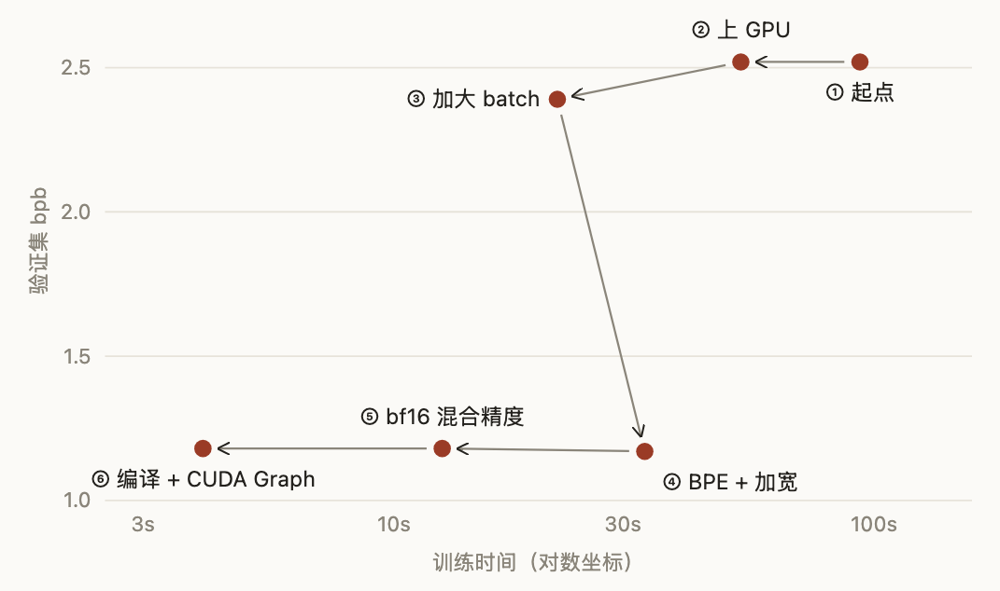

<div align="center">

# scratch2modern

从一个 200 行的 GPT 出发，一步步搭出现代大模型。每一步都有实验。<br>
From a 200-line GPT to a modern LLM — one change at a time, every step backed by experiments.

[中文](README.md) | [English](README_en.md)

[](https://github.com/LaugHan/scratch2modern/stargazers)
[](https://laughan.github.io/scratch2modern/)

### [📖 在线阅读](https://laughan.github.io/scratch2modern/)

<picture>
  <source media="(prefers-color-scheme: dark)" srcset="docs/assets/hero_dark.png">
  
</picture>

**训练时间 93.5s → 4.0s · 验证集 bpb 2.52 → 1.18** · 1 层 GPT · 单卡

</div>

## 这是什么

- 从 Karpathy 的 [microgpt](https://gist.github.com/karpathy/8627fe009c40f57531cb18360106ce95)（200 行纯 Python）出发；
- 一次只加一样东西，每一步都有对照实验；
- 单卡、小模型，代码和日志全部在仓库里，可以复现。

## 章节

### 第一章：训练

模型结构不动，只改怎么训练。

| 节 | 这一节加了什么 | 训练时间 | val bpb | 阅读 | 代码 |
| --- | --- | --- | --- | --- | --- |
| 1.01 | 起点：200 行纯 Python 的 GPT | 108.8 s¹ | — | [读](https://laughan.github.io/scratch2modern/1.01.html) | [src](src/ch1/1.01_microgpt) |
| 1.02 | 换成 PyTorch 张量 | 4.3 s¹ | — | [读](https://laughan.github.io/scratch2modern/1.02.html) | [src](src/ch1/1.02_torch) |
| 1.03 | batch，换到 TinyStories | 93.5 s | 2.52 | [读](https://laughan.github.io/scratch2modern/1.03.html) | [src](src/ch1/1.03_batch) |
| 1.04 | 搬到 GPU | 52.8 s | 2.52 | [读](https://laughan.github.io/scratch2modern/1.04.html) | [src](src/ch1/1.04_cuda) |
| 1.05 | BPE 分词器，模型加宽 | 33.3 s | 1.17 | [读](https://laughan.github.io/scratch2modern/1.05.html) | [src](src/ch1/1.05_tokenizer) |
| 1.06 | 优化器：SGD 到 Muon | — | — | [读](https://laughan.github.io/scratch2modern/1.06.html) | [src](src/ch1/1.06_optimizer) |
| 1.07 | 学习率调度 | — | — | [读](https://laughan.github.io/scratch2modern/1.07.html) | [src](src/ch1/1.07_schedule) |
| 1.08 | 数值精度：bf16 混合精度 | 12.6 s | 1.18 | [读](https://laughan.github.io/scratch2modern/1.08.html) | [src](src/ch1/1.08_precision) |
| 1.09 | 工程加速：编译、CUDA Graph 等 | 4.0 s | 1.18 | 写作中 | [src](src/ch1/1.09_engineering) |
| 1.10 | 训练细节：初始化、weight decay、裁剪、dropout | — | — | 写作中 | [src](src/ch1/1.10_details) |
| 1.11 | 回顾：每一步各贡献了多少 | — | — | 写作中 | [src](src/ch1/1.11_summary) |
| 1.12 | 放大到 6 层、531 万参数，在完整的 TinyStories 上训练 | 775 s | 0.589 | 写作中 | [src](src/ch1/1.12_full) |

训练时间和 val bpb 是这一节改完以后的结果，取自 [1.11](src/ch1/1.11_summary/notes.md) 的阶梯（1.12 除外）。"—"表示这一节比较完以后沿用了原来的做法，配置没有变。<br>
¹ 1.01、1.02 在 names 数据集上训练，没有 bpb。

### 第二章：模型结构

换到更大的模型和更多样的数据上（8 层、宽 512、7720 万参数，FineWeb-Edu，上下文 1024），对比各种架构改进。目前完成了基线。

## 快速开始

```bash
git clone https://github.com/LaugHan/scratch2modern && cd scratch2modern
uv sync
uv run src/ch1/1.01_microgpt/train.py   # 纯 Python，CPU 上约 2 分钟，会自动下载 names.txt
```

1.01、1.02 只需要 CPU。从 1.04 起需要一块 NVIDIA GPU，我们用的是一张 RTX 5880 Ada；第一章的模型很小，显存要求不高。从 1.03 起用 TinyStories，把验证集文件放到 `data/tinystories_valid.txt`。

## 每一步改了什么

每一节都是一个完整、能单独运行的目录。相邻两节 diff 一下，就是这一节的全部改动：

```bash
git diff --no-index src/ch1/1.01_microgpt/train.py src/ch1/1.02_torch/train.py
```

## 仓库结构

<details>
<summary>展开</summary>

每一章是 `src/` 下的一个目录，每一节是章里的一个目录。代码和 notes 的写法见 [src/CONVENTIONS.md](src/CONVENTIONS.md)。

```
data/                   # 数据集（不进 git），各章共用
src/
├── CONVENTIONS.md      # 项目、代码、notes 的规范
├── ch1/
│   └── 1.01_microgpt/
│       ├── train.py    # 这一节的完整代码
│       └── notes.md    # 改了什么、结果、笔记
└── ch2/
out/
└── ch1/1.01_microgpt/  # 这一节的输出：log.csv、samples.txt
docs/                   # 网站
```

</details>

## 路线图

- **第二章 模型结构**：位置编码、归一化、MLP、注意力、MoE 等，一项项补上主流模型的部件。
- **第三章 后训练**：让只会续写的模型听懂指令。
- **Infra**：一张卡放不下、算不完的时候怎么办。

## 致谢

起点代码来自 Andrej Karpathy 的 [microgpt](https://gist.github.com/karpathy/8627fe009c40f57531cb18360106ce95)。

---

如果这个项目对你有帮助，欢迎点个 ⭐
