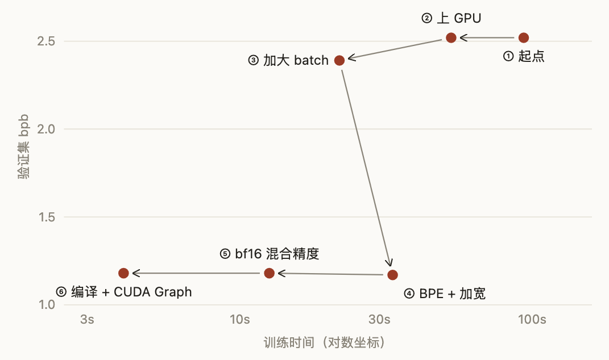

<div align="center">

# scratch2modern

From a 200-line GPT to a modern LLM — one change at a time, every step backed by experiments.<br>
从一个 200 行的 GPT 出发，一步步搭出现代大模型。每一步都有实验。

[中文](README.md) | [English](README_en.md)

[](https://github.com/LaugHan/scratch2modern/stargazers)
[](https://laughan.github.io/scratch2modern/)

### [📖 Read online](https://laughan.github.io/scratch2modern/) (Chinese for now)

<picture>
  <source media="(prefers-color-scheme: dark)" srcset="docs/assets/hero_dark.png">
  
</picture>

**Training time 93.5s → 4.0s · val bpb 2.52 → 1.18** · 1-layer GPT · single GPU

</div>

## What is this

- Starts from Karpathy's [microgpt](https://gist.github.com/karpathy/8627fe009c40f57531cb18360106ce95) (200 lines of pure Python);
- Adds one thing at a time, and every step comes with a controlled experiment;
- Single GPU, small models; all code and logs are in this repo, so everything is reproducible.

The write-ups on the website are in Chinese for now; an English version is planned.

## Chapters

### Chapter 1: Training

The model architecture stays fixed; only the training changes.

| Section | What it adds | Train time | val bpb | Read | Code |
| --- | --- | --- | --- | --- | --- |
| 1.01 | Starting point: a GPT in 200 lines of pure Python | 108.8 s¹ | — | [read](https://laughan.github.io/scratch2modern/1.01.html) | [src](src/ch1/1.01_microgpt) |
| 1.02 | PyTorch tensors | 4.3 s¹ | — | [read](https://laughan.github.io/scratch2modern/1.02.html) | [src](src/ch1/1.02_torch) |
| 1.03 | Batching; switch to TinyStories | 93.5 s | 2.52 | [read](https://laughan.github.io/scratch2modern/1.03.html) | [src](src/ch1/1.03_batch) |
| 1.04 | Move to GPU | 52.8 s | 2.52 | [read](https://laughan.github.io/scratch2modern/1.04.html) | [src](src/ch1/1.04_cuda) |
| 1.05 | BPE tokenizer, wider model | 33.3 s | 1.17 | [read](https://laughan.github.io/scratch2modern/1.05.html) | [src](src/ch1/1.05_tokenizer) |
| 1.06 | Optimizers: SGD to Muon | — | — | [read](https://laughan.github.io/scratch2modern/1.06.html) | [src](src/ch1/1.06_optimizer) |
| 1.07 | Learning rate schedules | — | — | [read](https://laughan.github.io/scratch2modern/1.07.html) | [src](src/ch1/1.07_schedule) |
| 1.08 | Numeric precision: bf16 mixed precision | 12.6 s | 1.18 | [read](https://laughan.github.io/scratch2modern/1.08.html) | [src](src/ch1/1.08_precision) |
| 1.09 | Engineering: compile, CUDA Graph, etc. | 4.0 s | 1.18 | in progress | [src](src/ch1/1.09_engineering) |
| 1.10 | Training details: init, weight decay, clipping, dropout | — | — | in progress | [src](src/ch1/1.10_details) |
| 1.11 | Recap: what each step contributed | — | — | in progress | [src](src/ch1/1.11_summary) |
| 1.12 | Scale to 6 layers / 5.3M params on full TinyStories | 775 s | 0.589 | in progress | [src](src/ch1/1.12_full) |

Train time and val bpb are the results after each section's change, taken from the ladder in [1.11](src/ch1/1.11_summary/notes.md) (except 1.12). "—" means the section compared options and kept the existing setup.<br>
¹ 1.01 and 1.02 train on the names dataset, so there is no bpb.

### Chapter 2: Architecture

A larger model on more diverse data (8 layers, width 512, 77M params, FineWeb-Edu, context 1024), comparing architectural improvements. The baseline is done.

## Quick start

```bash
git clone https://github.com/LaugHan/scratch2modern && cd scratch2modern
uv sync
uv run src/ch1/1.01_microgpt/train.py   # pure Python, ~2 min on CPU, downloads names.txt automatically
```

1.01 and 1.02 run on CPU. From 1.04 on you need an NVIDIA GPU; we use a single RTX 5880 Ada, and the Chapter 1 models are tiny. From 1.03 on, put the TinyStories validation file at `data/tinystories_valid.txt`.

## What changed in each step

Every section is a complete, standalone directory. Diff two adjacent sections to see exactly what that section changed:

```bash
git diff --no-index src/ch1/1.01_microgpt/train.py src/ch1/1.02_torch/train.py
```

## Repository layout

<details>
<summary>Expand</summary>

Each chapter is a directory under `src/`, and each section is a directory inside it. Conventions for code and notes: [src/CONVENTIONS.md](src/CONVENTIONS.md) (Chinese).

```
data/                   # datasets (not in git), shared by all chapters
src/
├── CONVENTIONS.md      # conventions for the project, code and notes
├── ch1/
│   └── 1.01_microgpt/
│       ├── train.py    # full code for this section
│       └── notes.md    # what changed, results, notes
└── ch2/
out/
└── ch1/1.01_microgpt/  # outputs of this section: log.csv, samples.txt
docs/                   # the website
```

</details>

## Roadmap

- **Chapter 2, Architecture**: positional encoding, normalization, MLP, attention, MoE — adding the parts of modern models one by one.
- **Chapter 3, Post-training**: turning a model that only continues text into one that follows instructions.
- **Infra**: what to do when one GPU can't hold or finish the job.

## Acknowledgements

The starting code is Andrej Karpathy's [microgpt](https://gist.github.com/karpathy/8627fe009c40f57531cb18360106ce95).

---

If this project helps you, a ⭐ is appreciated.
