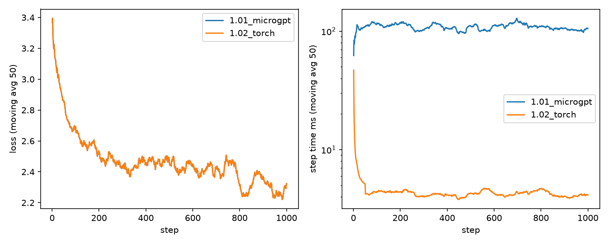

# 1.02 PyTorch

把 microgpt 里手写的标量自动求导（`Value`）换成 PyTorch 的张量。模型、初始权重、数据顺序都不变，只换计算方式：原来每个数都是一个节点，现在一个矩阵就是一个节点，`linear` 从一个双重循环变成一次矩阵乘法，注意力的多个头也一次算完。

为了能和 1.01 逐数比较，初始权重仍然用 Python 的 `random.gauss` 生成，计算用 float64。

## 观察

| | 1.01 microgpt | 1.02 torch |
|---|---|---|
| 最后 50 步平均 loss | 2.3233 | 2.3233 |
| 每步耗时 | 108.8 ms | 4.3 ms |

- 两版完全一致：1000 步里每一步的 loss 差值都是 0，生成的名字也一字不差。
- 快了约 25 倍。加速来自把成千上万个标量运算合并成少数几个矩阵运算，Python 层面的开销大幅减少。
- 只用 1 个 CPU 线程。PyTorch 默认会用满所有核，但这里每次运算的张量很小（16 维向量乘 16×16 矩阵），拆给多个线程时，线程之间协调的开销比计算本身还大。实测默认线程数下反而慢了十几倍。
