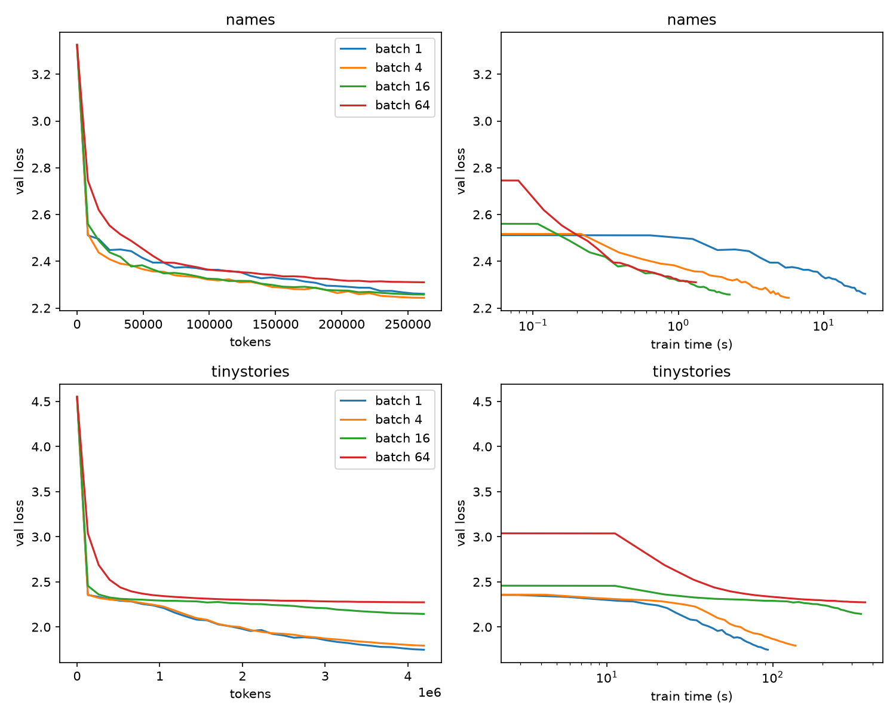

# 1.03 Batch

从一次一个 token 变成一次一批：输入的形状从一个 token 变成 `(B, T)`，所有位置一次算完，用因果 mask 保证每个位置只看得到它之前的 token。数据也改成把所有文本拼成一条长序列，每次随机截取 B 个长度为 T 的窗口。

在两个数据集上对比 batch size 1、4、16、64。为了公平，所有 batch size 训练的总 token 数相同，batch 越大，步数越少。学习率固定为 0.01。

| | names | TinyStories |
|---|---|---|
| 上下文长度 T | 16 | 256 |
| 总 token 数 | 2¹⁸ ≈ 26 万 | 2²² ≈ 420 万 |
| 步数（batch 1 → 64） | 16384 → 256 | 16384 → 256 |

## 观察

| batch | names val loss | names tokens/s | TinyStories val loss | TinyStories tokens/s |
|---|---|---|---|---|
| 1 | 2.261 | 13.6k | 1.748 | 44.9k |
| 4 | 2.244 | 45.6k | 1.794 | 30.5k |
| 16 | 2.258 | 116.3k | 2.145 | 12.3k |
| 64 | 2.310 | 198.4k | 2.274 | 11.6k |

- **同样的 token 数下，loss 并不是 batch 越大越好。** batch 越大，更新次数越少。在 names 上，batch 1 到 16 差别不大，只有 batch 64 明显变差。在 TinyStories 上差别更大：所有 batch 都先很快降到 2.3 左右并停住，batch 1 和 4 后来突破了这个平台，降到 1.75 左右；batch 16 到末尾才开始下降，batch 64 一直停在平台上。
- **2.3 左右的平台**大致是"只靠前一两个字符猜下一个"的水平。突破它，意味着模型开始用注意力去看更远的上下文。
- **batch 能不能提速，取决于瓶颈在哪里。** names 的张量很小，时间主要花在每个算子的调用开销上，batch 越大开销分摊得越开，batch 64 比 batch 1 快约 15 倍。TinyStories 上 batch 越大反而越慢，主要原因是内存分配：注意力矩阵（B×4×256×256 个 float64）在 batch 16 以上超过 32 MB，glibc malloc 每次都向系统要新内存页，缺页和清零的开销很大。详见 1.04 的速度分析。
- 学习率对所有 batch 都固定为 0.01。通常 batch 越大，最优学习率也越大，所以大 batch 吃亏有一部分是学习率造成的。
