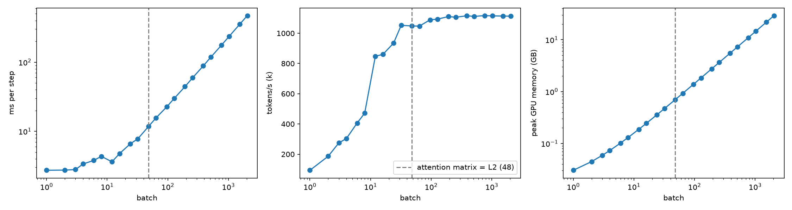

# 1.04 速度分析

1.04 里 GPU 最快也只用到了 float64 峰值的约 7%，CPU 更低。这里分析硬件理论上能多快、我们实际多快，以及差距在哪里。

所有数字都是 float64、TinyStories 设置（宽度 16、上下文 256、词表 89、1 层），CPU 单线程。

## 1. 硬件上限

| | CPU（AMD EPYC 9554，1 线程） | GPU（RTX 5880 Ada） |
|---|---|---|
| float64 理论峰值 | 60 GFLOPS | 1082 GFLOPS |
| float64 矩阵乘法实测 | 48 GFLOPS | 1044 GFLOPS |
| 内存带宽实测（拷贝） | 34 GB/s | 840 GB/s |
| 启动一个最小算子 | 2.8 μs | 5.3 μs |

理论峰值的算法：
- CPU：Zen 4 每个时钟周期能做 16 次 float64 运算（2 个 FMA 单元 × 每次 4 个 float64 × 每次 FMA 算 2 次运算），乘以 3.75 GHz。
- GPU：110 个 SM × 128 个 FP32 单元 × 2 × 2.46 GHz = 69.3 TFLOPS（float32），float64 只有它的 1/64。

## 2. 模型的计算量

每个 token 前向一次的运算量：

| | FLOPs |
|---|---|
| 矩阵乘法（q, k, v, o, MLP, lm_head） | 8992 |
| 注意力（q·kᵀ 和 权重·v，算满 256 个位置） | 16384 |
| 前向合计 | 25376 |
| 训练（前向 + 反向 ≈ 3 倍前向） | 76128 |

模型很窄（宽度 16），上下文却很长（256），所以大部分计算量在注意力上，而不是在参数上。

## 3. 实测速度与 MFU

MFU（模型 FLOPs 利用率）= 实际 FLOPS ÷ 硬件理论峰值。实际 FLOPS = tokens/s × 每个 token 的训练 FLOPs。

| batch | CPU tokens/s | CPU MFU | GPU tokens/s | GPU MFU |
|---|---|---|---|---|
| 1 | 44.9k | 5.7% | 79k | 0.6% |
| 4 | 30.5k | 3.9% | 281k | 2.0% |
| 16 | 12.3k | 1.6% | 750k | 5.3% |
| 64 | 11.6k | 1.5% | 950k | 6.7% |

MFU 这么低，根本原因是**算术强度**（每从显存读写 1 字节能做多少次运算）太低。这张卡 float64 的算力 ÷ 带宽约 1.3 FLOP/字节，模型的算术强度低于这个值，算力就会闲着等数据。我们的模型很窄（宽度 16，每个头 4 维），注意力矩阵上的逐元素运算每字节只做约 0.1 次运算，所以 GPU 大部分时间在搬数据。大模型训练常见的 MFU 在 30%～50%，前提是模型足够宽，时间主要花在大矩阵乘法上。

## 4. GPU 为什么是这个速度

一个训练步大约要启动 280 个 kernel（每个 PyTorch 算子在 GPU 上对应一个或几个 kernel）。

- **batch 小时，瓶颈在启动开销。** batch 1 每步 3.2 ms，GPU 真正在计算的只有 1.3 ms（约 40%），其余时间都在等 CPU 一个接一个地发出 kernel。所以 batch 从 1 增大到 16，每步耗时几乎不变，tokens/s 接近线性增长。
- **batch 大时，瓶颈在显存带宽。** batch 64 每步 17 ms，GPU 有 97% 的时间在忙。其中约 8.5 ms 花在逐元素运算上（softmax、mask、除法、乘法……），约 6.8 ms 花在矩阵乘法上。注意力矩阵是 64 × 4 × 256 × 256 个 float64，约 134 MB。逐元素运算每次都要把它整个读一遍、写一遍，8.5 ms × 840 GB/s ≈ 7 GB，相当于把这个矩阵来回搬了约 50 次。
- **矩阵乘法本身也被带宽卡住了。** 每个头只有 4 维（16 ÷ 4），q·kᵀ 每读一个数只做很少的运算，却要写出一个 256 × 256 的大矩阵。按 FLOPs 算，整个训练步只需要约 1.2 ms 的 float64 计算。
- **所以 MFU 低，并不是因为 float64 慢，而是这个模型每搬一个字节的数据只做很少的计算。** 即使换成 float32，算得快了也帮助有限，带宽仍然是瓶颈（数据量减半，会快一些）。

## 5. batch 一直加大会怎样

用 `batch_sweep.py` 把 batch 从 1 一直加到显存放不下。每个 batch 只测速度，不做训练。

| batch | ms/步 | tokens/s | 显存峰值 |
|---|---|---|---|
| 1 | 2.73 | 94k | 0.03 GB |
| 2 | 2.75 | 186k | 0.04 GB |
| 4 | 3.37 | 304k | 0.07 GB |
| 8 | 4.34 | 471k | 0.13 GB |
| 12 | 3.62 | 848k | 0.19 GB |
| 16 | 4.76 | 860k | 0.24 GB |
| 32 | 7.78 | 1052k | 0.47 GB |
| 64 | 15.64 | 1047k | 0.93 GB |
| 256 | 59.26 | 1106k | 3.66 GB |
| 1024 | 235.16 | 1115k | 14.59 GB |
| 2048 | 471.11 | 1113k | 29.17 GB |
| 3072 | 显存放不下 | | |

虚线是"一份注意力矩阵正好装满 96MB L2 缓存"的位置（batch 48）。

- **吞吐分三段：**
  - **先线性上升。** batch 很小时，每步耗时几乎不变（约 2.7 ms），GPU 在等 CPU 发出下一个 kernel，所以 batch 加大几乎是免费的。
  - **然后拐平。** 拐点在 batch 32 左右，从这里开始，GPU 的计算时间超过了 CPU 发指令的时间。
  - **最后是平台。** 过了拐点，每步耗时和 batch 成正比，吞吐停在约 110 万 tokens/s（MFU 约 7.8%），一直到显存放不下都不再变。
- **过了拐点，吞吐不会下降，只是不再上涨。** 这时瓶颈是显存带宽：batch 翻倍，要搬的数据也翻倍，时间跟着翻倍。这里的"搬运"是 GPU 显存和计算单元之间的读写，不是 CPU 往 GPU 传数据（每步只传约 32KB）。
- **预想中 L2 缓存带来的台阶没有出现。** batch 48 时，一份注意力矩阵正好是 96MB，等于 L2 的大小，但前后速度没有变化。原因有两个：
  - 每一步同时存在的大矩阵不止一份：显存峰值约是一份注意力矩阵的 7 倍，batch 十几时就已经超出 L2 了。
  - 逐元素运算对每个数只读写一次，就算放得进缓存，也没有机会重复使用。
- **显存随 batch 线性增长，每个样本约 14 MB，**大约是 7 份注意力矩阵（前向的中间结果要留到反向用）。batch 2048 用了 29 GB，3072 需要约 44 GB，再加上分配器的碎片，超过了 47 GB，所以放不下。
- **小插曲：batch 4 到 8 反而比 batch 12 慢。** 两次测量都能复现。profiler 显示，同一个矩阵乘法 kernel 在 batch 8 时每步要 2.1 ms，在 batch 12 时只要 0.9 ms。推测是 cuBLAS 对不同形状选择了不同的并行切分方式，batch 8 正好选到了一个并行度低的方案。
- **吞吐最高，不等于训练效果最好。** 1.03 里，同样的 token 数下，batch 越大 loss 越差。对这个模型来说，batch 32 已经拿到了几乎全部的吞吐，再加大只会让每步更慢、更新次数更少。

## 6. CPU 为什么慢

- **单线程的硬件上限本来就低：** 带宽只有 GPU 的约 1/25，算力只有约 1/20。
- **CPU 同样受带宽限制。** 排除下面这个 malloc 问题之后，不管 batch 多大，CPU 每个 token 都要约 22 μs（约 44k tokens/s）。CPU 没有启动开销需要分摊，所以 batch 大小对它没有帮助。
- **1.03 里"batch 越大越慢"，主要是 malloc 造成的。** Linux 的 glibc malloc 分配大块内存时，会直接向操作系统要新的内存页，用完再还回去。之后每次写入新页都会触发缺页中断，并且要先把整页清零。glibc 会根据程序的分配情况自动调高这个阈值，但上限是 32 MB。batch 16 以上的注意力矩阵都大于 32 MB，所以每次运算都走这条慢路径。把阈值手动调到 1 GB 之后：

| batch | 默认 malloc（ms/步） | 调大阈值后（ms/步） |
|---|---|---|
| 1 | 12.7 | 5.7 |
| 4 | 46.0 | 21.8 |
| 16 | 371.8 | 93.5 |
| 64 | 1463.4 | 403.2 |

（batch 1 在训练脚本里本来就是 5.9 ms。训练中加载数据、评估验证集的大块分配，已经让 glibc 自动调高了阈值。上表来自一个单独的测试脚本，它没有这些分配，所以默认值下更慢。）

调大阈值的方法：运行前设置环境变量 `MALLOC_MMAP_THRESHOLD_=1073741824 MALLOC_TRIM_THRESHOLD_=4294967296`。

## 7. 计时上的坑

- **GPU 是异步执行的。** Python 把 kernel 交给 GPU 后立刻返回，所以停表之前必须先等 GPU 算完（`torch.cuda.synchronize()`，或者先调用一次 `.item()`）。1.04 最初把 `.item()` 放在停表之后，batch 64 的速度被高估了近 3 倍（2.69M tokens/s，实际是 0.95M）。
- **CPU 的速度会被内存分配方式左右。** 见上一节。

## 脚本

- `peak.py`：实测硬件上限（矩阵乘法 FLOPS、内存带宽、启动一个最小算子的开销）
- `flops.py`：每个 token 的 FLOPs，以及 1.03 和 1.04 实测的 FLOPS 与 MFU
- `profile_step.py`：用 PyTorch profiler 拆解一个训练步（CPU 部分会受 malloc 影响，见第 6 节）
- `batch_sweep.py`：GPU 上 batch 从 1 扫到显存放不下，记录每步耗时、吞吐和显存
