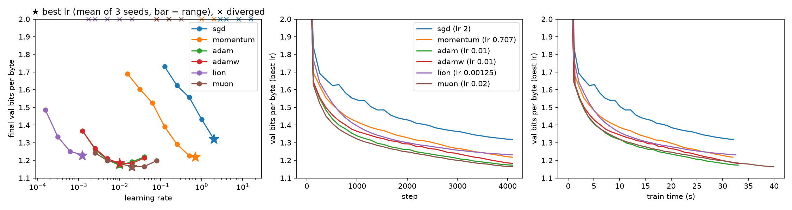

# 1.06 优化器

之前一直用 microgpt 自带的 Adam。这一节手写 6 个优化器，比较它们的效果：SGD、SGD + momentum、Adam、AdamW、Lion、Muon。每个优化器在 `optimizers/` 里一个文件。它们各自想解决什么问题、在大模型训练中的情况，见 [optimizers/README.md](optimizers/README.md)。

**从这一节开始，基础设置改为 bpe1024、宽度 48**（13.8 万参数）。这是 1.05 analysis 里参数量相同时效果最好的组合。其余不变：TinyStories、上下文 256、batch 16、4096 步、学习率线性衰减、float64。

不同优化器的合适学习率可以差上千倍，用同一个学习率比没有意义。所以：

- **每个优化器单独扫学习率**，相邻两点差 2 倍，比较各自最好的结果。如果最佳点紧挨着发散点，再在中间补一个点。
- **在最佳学习率上再换 2 个种子**，一共 3 次，看结果的波动有多大。几个优化器之间的差距只有 0.01 左右，这和种子带来的波动是同一个量级。

## 观察

| 优化器 | 最佳 lr | val bpb（3 个种子的均值） | 3 个种子的范围 | 不发散的 lr | 训练时间 | 额外状态 |
|---|---|---|---|---|---|---|
| sgd | 2 | 1.3191 | 1.3144 ~ 1.3242 | 0.125 ~ 2 | 32 s | 无 |
| momentum | 0.707 | 1.2171 | 1.2166 ~ 1.2179 | 0.0156 ~ 0.707 | 32 s | 1× 参数量 |
| adam | 0.01 | 1.1757 | 1.1727 ~ 1.1778 | 0.00125 ~ 0.04 | 33 s | 2× |
| adamw | 0.01 | 1.1833 | 1.1824 ~ 1.1848 | 0.00125 ~ 0.04 | 33 s | 2× |
| lion | 0.00125 | 1.2258 | 1.2178 ~ 1.2311 | 0.00016 ~ 0.00125 | 33 s | 1× |
| **muon** | 0.02 | **1.1627** | 1.1613 ~ 1.1636 | 0.0025 ~ 0.08 | 40 s | 1.8× |

左图：横轴是学习率，纵轴是最终的 val bpb。★ 是最佳学习率，竖线是 3 个种子的范围，图顶部的 × 表示发散。中图和右图：每个优化器在最佳学习率下的 loss 曲线，横轴分别是步数和时间。

- **分成两档。** Muon、Adam、AdamW 是一档，彼此相差不到 0.02；momentum、Lion、SGD 是另一档，比前一档差 0.03 到 0.16。
- **前三名的排名是可信的。** Muon 比 Adam 好 0.013，Adam 比 AdamW 好 0.008，都大于各自种子之间的波动（0.002 到 0.005）。momentum 和 Lion 之间只差 0.009，比 Lion 自己的种子波动（0.013）还小，所以算打平。
- **SGD 和 momentum：学习率越大越好，直到发散。** 它们的最佳点都紧挨着发散点，看不到曲线的谷底。它们只有一个全局的学习率，这个学习率被最陡的方向卡住了。momentum 能把震荡抵消掉，等效步长可以比 SGD 大好几倍，所以比 SGD 好了 0.10。
- **Adam 和 Muon 好调。** 它们在很宽的学习率范围内都不发散，曲线有一个平缓的谷底。Muon 的谷底最宽：0.01 到 0.04 的结果都在最佳值的 0.02 以内，Adam 只有 0.01 到 0.02。
- **Muon 按步数算最好，按时间算和 Adam 基本打平。** Muon 每步多花 21% 的时间：矩阵只有 48×48，5 次 Newton–Schulz 迭代的计算量很小，时间主要花在多出来的几十次 kernel 启动上，和 [1.04 的分析](../1.04_cuda/analysis/notes.md)一样。严格的按时间比较，需要让 Muon 只训练相同的时间（约 3400 步）并完整地衰减学习率，这里没有做。
- **weight decay（AdamW）略有害处。** 模型小、训练短，还处在"学不够"的阶段，不需要正则。
- **Lion 会在训练中途发散。** 学习率 0.0025 和 0.00177 分别在第 776 步和第 3403 步才发散。Lion 每个参数每步都走满 ±lr，我们又没有加 weight decay（原论文是加的），参数可能会慢慢变大，直到不稳定。这只是推测。
- **生成的文字**（Muon）：`Once upon a time, there was a little girl named Lily. She had a very pretty. She had a new friend...`

## 和大模型训练的对照

详细内容和出处见 [optimizers/README.md](optimizers/README.md)，这里只列结论：

- **一致的地方：**
  - SGD 不适合训练 Transformer。
  - Adam 系列好调、稳定，AdamW 是大模型预训练的事实标准（GPT-3、LLaMA、Chinchilla、DeepSeek-V3）。
  - Lion 和 AdamW 差不多。
  - Muon 这类"把权重当矩阵"的优化器更好。前沿模型正在转向 Muon：Kimi K2、GLM-4.5、DeepSeek-V4 都用了它。
- **不一致的地方，主要来自规模：**
  - **weight decay：** 在大模型的长时间训练中，它不只是正则，还能防止权重越来越大、超出 bf16 能表示的范围，所以是必需的。在我们这里，它反而有害。
  - **Muon 的开销：** 在大模型里，额外的计算量不到 1%；在我们这里，因为矩阵太小，时间都花在启动 kernel 上，额外开销有 21%。
  - **Muon 的优势有多大：** Moonshot 报告约 2 倍的计算效率；Wen et al. (2025) 把 AdamW 认真调好再比，发现只有 1.1 到 1.4 倍，而且模型越大越小。我们看到的差距（0.013 bpb）也不大。这也说明，比较优化器时，**每个优化器都要各自调好学习率**，否则比的其实是学习率。
