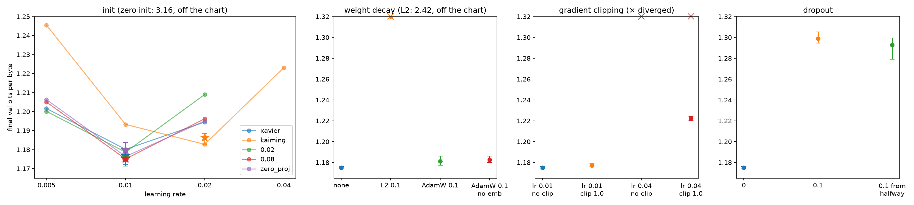
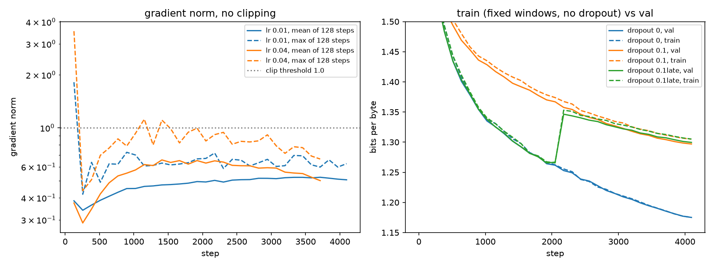
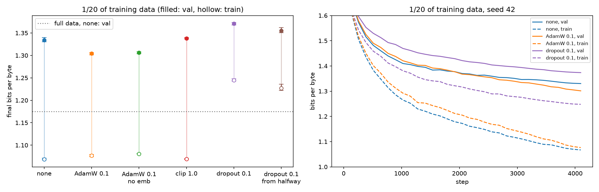

# 1.10 训练细节

大模型的训练配置里，除了优化器、学习率、精度，总还有一组"小参数"。这一节一项一项地试：初始化、weight decay、梯度裁剪、dropout。每一项要解决什么问题、主流怎么做、为什么这样做，见 [README.md](README.md)。这里只简单解释用到的几个名词：

- **初始化**：训练开始时参数取什么值。通常从正态分布 $N(0, \sigma^2)$ 里随机取，问题是 σ 取多大。
- **fan_in**：一个矩阵的每个输出由多少个输入加起来，也就是输入的维度。Xavier、Kaiming 这两种初始化按它来定 σ。
- **weight decay**：每一步把参数往 0 拉一点，防止参数无限变大。L2 是把它加进梯度里；AdamW 是把它和梯度分开、单独做。
- **梯度裁剪**：所有梯度拼成一个向量，长度超过上限时整体按比例缩小，防止偶尔一步走得太远。
- **dropout**：训练时随机把一部分激活置成 0，防止模型死记训练数据。
- **过拟合**：模型记住了训练数据，在训练集上很好，在新数据上变差。

基线是 1.09 打开全部加速以后的配置：bpe1024、宽度 48、上下文 256、batch 16、4096 步、Adam 学习率 0.01 线性衰减、bf16 混合精度、初始化 N(0, 0.08)，不加 weight decay、不裁剪、不加 dropout。

## 实验设计

每次只改一项，其余保持基线：

| 项目 | 对比 | 说明 |
|---|---|---|
| 初始化 | 全零、Xavier、Kaiming、0.02、0.08（基线）、0.02 + 残差输出层置零 | σ 差了 10 倍，所以每种都扫 3 个学习率（0.005、0.01、0.02），在最好的那个上跑 3 个种子 |
| weight decay | 不加（基线）、L2 0.1、AdamW 0.1、AdamW 0.1 但 embedding 不加 | 3 个种子 |
| 梯度裁剪 | 不裁剪（基线）、总长度裁到 1.0；学习率 0.01 和 0.04 各一组 | 1.07 里学习率 0.04 会中途发散，看裁剪能不能救回来。3 个种子 |
| dropout | 0（基线）、0.1、后半段才开 0.1 | 3 个种子 |

另外记录两样东西：
- **训练集上的 bpb**：在训练集上取和验证集同样多的固定窗口，用同样的方式评估，看两者有没有差距，也就是有没有过拟合；
- **梯度的总长度**：每 128 步的平均值和最大值，以及裁剪触发的比例。

## 结果

从左到右：初始化（每种初始化在不同学习率下的结果，★ 是最佳学习率上 3 个种子的均值，竖线是范围）、weight decay、梯度裁剪（× 表示发散）、dropout。L2 和全零初始化的结果太差，超出了图的范围。

左：不裁剪时梯度的总长度，学习率 0.01 和 0.04，实线是每 128 步的平均值，虚线是最大值。右：dropout 三种做法在训练集（虚线）和验证集（实线）上的 bpb。

### 初始化

| 做法 | 最佳学习率 | val bpb（3 个种子） | 种子范围 | 初始 val bpb |
|---|---|---|---|---|
| 全零 | — | 3.1614 | — | 3.16 |
| Xavier | 0.01 | 1.1766 | 1.1723 ~ 1.1802 | 3.19 |
| Kaiming | 0.02 | **1.1864** | 1.1828 ~ 1.1883 | **4.85** |
| 0.02 | 0.01 | 1.1755 | 1.1714 ~ 1.1787 | 3.17 |
| 0.08（基线） | 0.01 | 1.1751 | 1.1740 ~ 1.1763 | 3.24 |
| 0.02 + 输出层置零 | 0.01 | 1.1798 | 1.1764 ~ 1.1838 | 3.17 |

- **全零完全训练不动。** 3.16 正好是对 1024 个 token 均匀瞎猜的水平，所有梯度都是 0。
- **Xavier、0.02、0.08 打平，最佳学习率都是 0.01。** 它们的 σ 相差 7 倍。有 rmsnorm 以后，σ 的精确取值就不要紧了，这正是 GPT-1 用固定 0.02 的理由。
- **Kaiming 差了 0.011，最佳学习率也更大（0.02）。** 它的 σ 最大（约 0.2），一开始的 val bpb 是 4.85，比均匀瞎猜还差：lm_head 太大，一开始就很自信地猜错。
- **我原本的预期没有成立。** 我以为初始化越小，最好的学习率也越小，实际上 0.02 和 0.08 的最佳学习率一样。
- **残差输出层置零略差。** 我们只有 1 层，残差累积的问题还不存在。

### weight decay

| 做法 | val bpb（3 个种子） | 种子范围 |
|---|---|---|
| 不加（基线） | 1.1751 | 1.1740 ~ 1.1763 |
| L2 0.1 | **2.4195** | 2.4190 ~ 2.4199 |
| AdamW 0.1 | 1.1813 | 1.1773 ~ 1.1862 |
| AdamW 0.1，embedding 不加 | 1.1827 | 1.1800 ~ 1.1861 |

- **L2 0.1 用在 Adam 上，训练失败。** L2 往梯度里加的那一项（约 0.008）比真正的梯度（每个参数约 0.001）大好几倍。Adam 把它归一化以后，每一步都以满学习率把参数往 0 拉。这是 AdamW 要解决的问题被放大到了极致。
- **AdamW 两种做法都略差（+0.006、+0.008）。** 模型没有过拟合（见 dropout），不需要正则。

### 梯度裁剪

| 学习率 | 裁剪 | val bpb | 发散 |
|---|---|---|---|
| 0.01 | 不裁 | 1.1751 | 0 / 3 |
| 0.01 | 1.0 | 1.1772 | 0 / 3 |
| 0.04 | 不裁 | — | 3 / 3 |
| 0.04 | 1.0 | 1.2222（2 个种子） | 1 / 3 |

- **学习率 0.01 时，梯度的总长度平时只有 0.3 到 0.6**，碰不到 1.0，只在训练开头触发过一次。裁不裁一样。
- **学习率 0.04 时，开头几十步的梯度能冲到 3 到 6。** 不裁剪时 3 个种子全发散（2 个在前 128 步，1 个在第 3800 步左右）；裁剪救回了 2 个，但结果（1.222）远不如学习率 0.01，还有 1 个照样发散。
- 和 1.07 相比，学习率 0.04 发散得更早了（1.07 是在第 1315 步）。现在用的是 bf16 混合精度和编译，数值上和 1.07 的 fp64 不同。
- 梯度裁剪是**防偶尔尖峰的保险**，不能让本来就太大的学习率变得好用。

### dropout

| 做法 | val bpb（3 个种子） | 种子范围 | 训练集 bpb |
|---|---|---|---|
| 0（基线） | 1.1751 | 1.1740 ~ 1.1763 | 1.1760 |
| 0.1 | **1.2989** | 1.2945 ~ 1.3052 | 1.3052 |
| 后半段才开 0.1 | **1.2927** | 1.2791 ~ 1.2995 | 1.2991 |

- **dropout 差了 0.12。** 后半段才打开的那一组，打开那一刻 val bpb 立刻跳高 0.08，之后再也回不来。
- **训练集和验证集的 bpb 从头到尾几乎重合。** 数据过了约 2.7 遍，模型也完全没有死记。13.8 万个参数记不住 630 万个 token，模型处在"学不够"的阶段，dropout 只会削弱本来就不够的容量。
- 为了排除 bug，还做了两个检查：去掉 CUDA Graph、完全不编译，各跑一次 dropout 0.1，结果都一样（1.29 到 1.31）。dropout 降到 0.02 也还差 0.05。

## 让模型过拟合以后

上面的结果里，weight decay 和 dropout 都没有用，原因是模型根本没有过拟合，它们要解决的问题不存在。为了看它们真正起作用的样子，这里人为制造过拟合：**训练集只用前 1/20**（约 31 万个 token），验证集不变，其余和基线完全相同。4096 步下来，训练集要过约 53 遍。

每种做法跑 3 个种子（`sweep_small.sh`）。

左：每种做法训练集（空心）和验证集（实心）的最终 bpb，两点之间的竖线就是差距；灰色虚线是全量数据、什么都不加时的验证集结果。右：种子 42 的训练集（虚线）和验证集（实线）曲线。

| 做法 | 训练集 bpb | 验证集 bpb | 验证集的种子范围 | 差距 | 验证集相对基线 |
|---|---|---|---|---|---|
| 不加（基线） | 1.0686 | 1.3341 | 1.3302 ~ 1.3396 | 0.265 | — |
| AdamW 0.1 | 1.0766 | **1.3046** | 1.3013 ~ 1.3062 | 0.228 | **−0.029** |
| AdamW 0.1，embedding 不加 | 1.0807 | 1.3059 | 1.3037 ~ 1.3084 | 0.225 | −0.028 |
| 裁剪 1.0 | 1.0690 | 1.3382 | 1.3366 ~ 1.3398 | 0.269 | +0.004 |
| dropout 0.1 | 1.2448 | 1.3710 | 1.3676 ~ 1.3736 | 0.126 | +0.037 |
| 后半段才开 0.1 | 1.2267 | 1.3553 | 1.3507 ~ 1.3620 | 0.129 | +0.021 |

全量数据下，训练集和验证集只差 −0.001；这里差了 0.27。

- **过拟合出现了，但还没有到"验证集回升"的程度。** 所有做法的验证集最低点都在最后一步。模型在死记训练集，但还在学到一些能泛化的东西，只是学得越来越慢。学习率线性衰减到 0 也让后期的更新很小。
- **weight decay 起作用了：验证集好 0.029，3 个种子的范围完全不重叠。**
  - 它让训练集差了 0.008，换来验证集好 0.029。这是正则该有的样子：少记一点训练集，多泛化一点。
  - 从曲线上看，前 2000 步加了 weight decay 的验证集还略差，之后才拉开。它的效果是累积出来的：前期模型还在学通用的规律，没什么可防；后期开始死记了，"把参数往 0 拉"才有东西可以对抗。
  - 和全量数据对比：同样的 AdamW 0.1，没有过拟合时验证集差 0.006，有过拟合时好 0.029。**weight decay 有没有用，取决于有没有过拟合。**
  - embedding 加不加 weight decay，差别在种子波动以内。
- **dropout 缩小了差距，验证集却更差了。**
  - 差距从 0.27 缩到 0.13，看起来是在防过拟合。但缩小的方式是训练集一起变差了 0.18（训练集的 bpb 是关掉 dropout 测的）。验证集只能跟着变差。
  - 原因是模型太小：宽度只有 48，每次随机丢掉 10% 的激活，损失的不只是"死记"，还有"学会"。dropout 在 GPT-1/2 里有用，那时的模型宽度是 768，同样丢 10%，剩下的信息多得多。
  - 后半段才打开的那一组，损失小一些，但同样不划算。
- **梯度裁剪和过拟合无关，结果和预期一致。** 它管的是训练稳不稳，不管泛化。
- **最大的变量其实是数据量。** 1/20 数据下最好的结果是 1.305，全量数据什么都不加是 1.175。正则能补回来的，远比不上多给数据。大模型预训练的数据足够多，一般只过一遍，过拟合本来就不是主要矛盾。这也是它们不用 dropout 的原因。

## 和大模型训练的对照

详细内容和出处见 [README.md](README.md)，这里只列结论。

| 项目 | 大模型的主流做法 | 我们这里 | 为什么不一样 |
|---|---|---|---|
| 初始化 | 0.02（GPT 系列、Megatron-LM 默认、OLMo 2），残差输出层缩小或置零 | 0.08、0.02、Xavier 打平；输出层置零略差 | 只有 1 层，残差累积不是问题；有 rmsnorm，σ 不敏感 |
| weight decay | AdamW 0.1（GPT-3、LLaMA、DeepSeek-V3） | 不加最好；数据少到过拟合时，AdamW 0.1 好 0.029 | 大模型的数据基本只过一遍，不存在过拟合，weight decay 主要用来控制参数不要越长越大；我们训练太短，参数长不到会出问题的程度 |
| 梯度裁剪 | 总长度裁到 1.0（几乎所有大模型） | 加不加一样 | 梯度平时碰不到 1.0；大模型里 loss 尖峰更常见 |
| dropout | 预训练不用（LLaMA、PaLM） | 不加最好；过拟合时也是 | **一致**：大模型是因为不存在过拟合；我们的模型还太窄，丢 10% 的激活代价太大 |

这四项可以分成两类：
- **正则类**（weight decay、dropout）：防过拟合。我们离过拟合还很远。人为制造过拟合以后，weight decay 就起作用了。
- **稳定类**（初始化的细节、梯度裁剪）：防训练不稳定。我们的模型只有 1 层、有 rmsnorm、学习率不大，本来就稳定。

它们在大模型里有用的那些情况，我们的小模型都没有遇到。唯一完全一致的是 dropout：大模型不用它，我们也不该用，原因相同。
