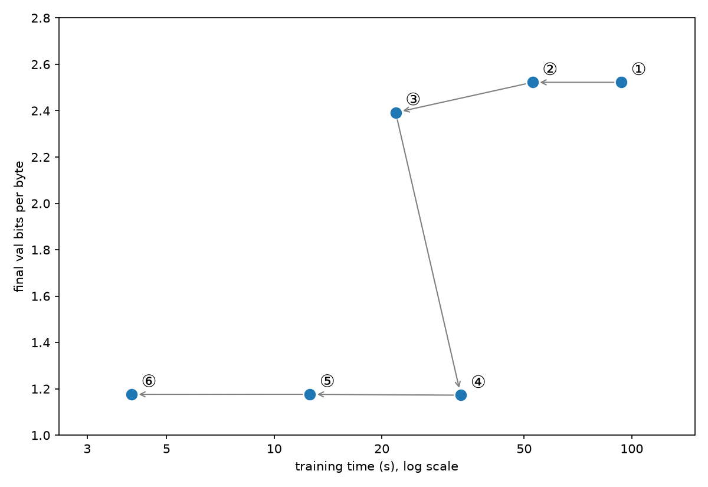

# 1.11 回顾：第一章的训练链路

第一章从 microgpt 出发，一次只改一样东西，把训练做得更快、更好。这一节不加新东西，而是把前面 10 节串起来：每一步改了什么，为什么有用，各自贡献了多少。

## 范围

先说清楚这一节**看的是什么、不看什么**：

- **只挑了真正改动了配置的关键几步。** 每一节都对比了好几种做法，这里只取最后采用的那一种。1.06（优化器）、1.07（学习率调度）、1.10（训练细节）对比完都沿用了原来的做法，所以不在阶梯上，放到后面单独说。1.08、1.09 里的多项改动也合并成一步。
- **这是一个玩具模型。** 1 层 Transformer，宽度 48，13.8 万个参数。数据只有 TinyStories 官方验证集那一个文件（约 2200 万个字符），训练 4 秒。大模型有几十层、几十亿以上的参数，要训练几万亿个 token。所以这里看到的"哪一步贡献最大"，只对这个规模成立。哪些结论能推广、哪些不能，见"我们的结论，在真实的大模型里成立吗"一节。
- **每个点只跑了一个种子。** 前面各节已经测过种子之间的波动（val bpb 约 ±0.003），比这里各步之间的差距小得多。

## 阶梯

每个点是一次训练，横轴是训练时间，纵轴是最终的验证集 bpb。每个点在上一个点的基础上多改一样东西：
- ① CPU、字符分词、宽度 16、每步 1 个窗口（1.03）；
- ② 搬到 GPU（1.04）；
- ③ 每步 16 个窗口，训练 4096 步（1.05）；
- ④ 换成 bpe1024，宽度加到 48（1.05、1.06）；
- ⑤ bf16 混合精度（1.08）；
- ⑥ 去掉同步、fused Adam、SDPA、编译 + CUDA Graph（1.09），也就是现在的配置。

| | ① | ② | ③ | ④ | ⑤ | ⑥ 现在 |
|---|---|---|---|---|---|---|
| 设备 | CPU | **GPU** | GPU | GPU | GPU | GPU |
| 分词器 | char | char | char | **bpe1024** | bpe1024 | bpe1024 |
| 宽度 / 参数量 | 16 / 1.0 万 | 16 / 1.0 万 | 16 / 1.0 万 | **48 / 13.8 万** | 48 / 13.8 万 | 48 / 13.8 万 |
| 每步的数据 | 1 × 256 | 1 × 256 | **16 × 256** | 16 × 256 | 16 × 256 | 16 × 256 |
| 步数 | 16384 | 16384 | **4096** | 4096 | 4096 | 4096 |
| 看过的文本 | 4.2 MB | 4.2 MB | **16.8 MB** | **53 MB** | 53 MB | 53 MB |
| 精度 | fp64 | fp64 | fp64 | fp64 | **bf16 混合** | bf16 混合 |
| 编译等工程加速 | 无 | 无 | 无 | 无 | 无 | **有** |
| 最终 val bpb | 2.52 | 2.52 | 2.39 | **1.17** | 1.18 | 1.18 |
| 训练时间 | 93.5 s | 52.8 s | 21.9 s | 33.3 s | 12.6 s | **4.0 s** |
| 吞吐（字节/秒） | 4.5 万 | 8.0 万 | 77 万 | 160 万 | 420 万 | **1330 万** |
| 峰值显存 | — | 216 MB | 311 MB | 299 MB | **148 MB** | **99 MB** |

每一列加粗的格子，就是这一步改的东西。最后 4 行是结果。说明：
- **吞吐**按每秒处理的文本字节数算，不按 token 数算。这样字符分词和 BPE 才能比。
- **峰值显存**包含放在 GPU 上的数据。①在 CPU 上跑，没有显存。
- ④的数字取自 1.08 的 fp64 那次，用的是 PyTorch 的 Adam，和 1.06 手写的 Adam 数学上相同。

## 每一步在干嘛

### 起点之前：1.01 → 1.02，从标量到张量

阶梯从 ① 开始，但在它之前还有两步，是在 names 数据集上做的，bpb 不能放进同一张图：
- **1.01** 是 Karpathy 的 microgpt 原版：纯 Python，每个数都是一个自动求导的节点，每秒只能处理 66 个字节。
- **1.02** 把它换成 PyTorch 张量：一个矩阵就是一个节点，矩阵乘法交给底层的 C++ 实现。每一步的 loss 和 1.01 完全相同，快了约 25 倍。
- **1.03** 再把"一次一个 token"改成"一次一整个窗口"：所有位置一起算，用因果 mask 保证每个位置只看得到前面的 token。这就是 ①。

这几步都没有改变数学，只是把同样的计算交给更擅长的执行方式。从 1.01 的 66 字节/秒，到 ① 的 4.5 万字节/秒，已经快了约 700 倍。

### ① → ②：搬到 GPU，只快了 1.8 倍

参数和数据都放到 GPU 上，计算完全不变，bpb 也一模一样（2.52）。但只快了 1.8 倍（93.5 秒 → 52.8 秒）。

原因是每步只算 1 个窗口，计算量太小。每一步要启动约 280 个 GPU kernel（kernel 就是 GPU 上执行的一个小程序），每个只算一点点。时间主要花在 CPU 一个一个地启动它们上，GPU 大部分时间在等。见 [1.04](../1.04_cuda/notes.md)。

### ② → ③：加大 batch，又快又好

每步从 1 个窗口改成 16 个，训练从 16384 步改成 4096 步，看过的文本多了 4 倍：
- **更快**：每步的计算量大了 16 倍，但启动 kernel 的次数不变。启动开销被分摊开，吞吐涨了约 10 倍（8.0 万 → 77 万字节/秒）。
- **更好**：同样的时间里能看更多文本，bpb 从 2.52 降到 2.39。

batch 只有在 GPU 上才划算。[1.03](../1.03_batch/notes.md) 在 CPU 上试过，batch 越大反而越慢：CPU 本来就在满负荷计算，没有可以分摊的启动开销。

### ③ → ④：换分词器、加宽模型，bpb 降了一半

这是唯一一步让 bpb 大幅下降的改动：2.39 → 1.17。它包含两件事：
- **bpe1024**（[1.05](../1.05_tokenizer/notes.md)）：把常见的字符组合合并成一个 token，平均每个 token 对应 3.2 个字节。同样 4096 步，看过的文本从 16.8 MB 变成 53 MB。256 个 token 的上下文也从 256 个字符变成约 800 个字符，模型一次能看到更多内容。
- **宽度 16 → 48**（1.05 analysis，从 1.06 起采用）：参数从 1.0 万增加到 13.8 万。词表变大以后，embedding 和输出层占了大头，宽度 16 根本放不下。在参数量相同时比较，bpe1024 配宽度 48 最好。

代价是每步的计算量变大了，训练时间从 21.9 秒涨到 33.3 秒。但按字节算，吞吐反而翻了一倍：每个 token 对应的文本多了 3 倍。

### ④ → ⑤：bf16 混合精度，快了 2.6 倍，显存减半

[1.08](../1.08_precision/notes.md) 把矩阵乘法从 fp64 换成 bf16，参数的主副本和 Adam 的状态仍然保持 fp32：
- **更快**：33.3 秒 → 12.6 秒。这张卡的 fp64 只有 fp32 的 1/64，bf16 还能用上专门做矩阵乘法的 Tensor Core。
- **显存减半**：299 MB → 148 MB。反向传播要用的中间结果，大部分从每个 8 字节变成 2 字节。
- **代价很小**：bpb 只差了约 0.003，和种子之间的波动同一个量级。

### ⑤ → ⑥：工程加速，又快了 3.2 倍

[1.09](../1.09_engineering/notes.md) 数学完全不变，只减少 CPU 和 GPU 之间的等待：
- **去掉每步的同步**：不再每步把 loss 读回 CPU，CPU 可以提前把后面的活排进队列；
- **fused Adam**：把每个参数各自的几次更新，合并成一个 kernel；
- **SDPA**：PyTorch 自带的注意力实现（内部是 FlashAttention），不再把注意力矩阵写到显存里；
- **torch.compile**：把很多小运算融合成少数几个 kernel，每步的 kernel 从约 190 个降到 85 个；
- **CUDA Graph**：把一整步的 kernel 录下来，之后一次性提交，CPU 每步只需要启动 12 次。

每步从 3.56 毫秒降到 0.85 毫秒，训练时间从 12.6 秒降到 4.0 秒。显存也从 148 MB 降到 99 MB：融合以后，很多中间结果不用再存下来。

## 没有改动配置的几节

这三节不在阶梯上，但它们回答了"原来的做法够不够好"：
- **[1.06 优化器](../1.06_optimizer/notes.md)**：比较了 SGD、momentum、Adam、AdamW、Lion、Muon。Adam 比 SGD 好很多，Muon 还略好一点。保留 Adam，因为大模型的经验大多来自 AdamW，用它更好对照。
- **[1.07 学习率调度](../1.07_schedule/notes.md)**：只要最后衰减到 0，线性、cosine、WSD 的差别都在种子波动以内；不衰减明显更差。warmup 在这个模型上没有用处。
- **[1.10 训练细节](../1.10_details/notes.md)**：初始化只要不是全零、σ 不太大就行；weight decay、梯度裁剪、dropout 都没有用处，因为模型没有过拟合，也没有不稳定。人为制造过拟合以后，weight decay 才开始起作用。

### Muon + WSD

在现在的配置（⑥）上换上 Muon 和 WSD，3 个种子的结果：

| 组合 | val bpb | 训练时间 |
|---|---|---|
| Adam + 线性衰减（现在） | 1.1769 | 4.0 s |
| Adam + WSD | 1.1731 | 4.5 s |
| Muon + 线性衰减 | 1.1644 | 13.1 s |
| Muon + WSD | **1.1604** | 13.1 s |

- **Muon 让结果更好了，却让训练慢了 3 倍。** Muon 每一步要对每个矩阵做 5 次 Newton–Schulz 迭代，算出近似正交化的更新。在这么小的矩阵上，这些运算的时间几乎全花在 CPU 启动 kernel 上：一步要 1.9 毫秒，而 fused Adam 只要 0.04 毫秒，前向加反向一共也才不到 1 毫秒。
- **PyTorch 自带的 Muon 没法直接编译**（编译器会主动跳过它的 step）。手写一个批量计算、再编译的版本，一步能降到 0.6 毫秒，但还是比 Adam 慢一倍。单是 GPU 计算就要约 0.47 毫秒。
- 到了大模型上，这部分额外计算只占总计算量的 1% 左右（Keller Jordan 的估计），问题就不存在了。**算法上更好，要配上工程才能变成更快**；在玩具模型上，配不上。
- WSD 比线性衰减略好（约 0.004），和 1.07 的结论一致。它真正的好处是"随时可以停"，在这里体现不出来。

## 我们的结论，在真实的大模型里成立吗

这一章的每个结论都来自一个 13.8 万参数、训练 4 秒的玩具模型，**不一定对真实的大模型成立**。为了说清楚这一点，下面对照 2025–26 年几个公开了训练细节的开源模型，看它们在**本章讨论过的这些部件上**是怎么选的。只对照这些部件；它们在模型结构等方面的其他改动，留到后面的章节。

对照的模型和规模：

| 模型 | 参数量 | 训练 token 数 |
|---|---|---|
| 我们 | 13.8 万 | 约 1700 万（53 MB 文本） |
| DeepSeek-V4-Pro | 1.6 万亿 | 33 万亿 |
| Kimi K3 | 2.8 万亿 | 没写 |
| GLM-5 | 7440 亿 | 28.5 万亿 |
| Qwen3 | 最大 2350 亿 | 36 万亿 |
| Gemma 4 | 最大 310 亿 | 没写 |

参数量差了 100 万倍以上，数据差了 100 万倍以上。

### 一致的地方

| 部件 | 我们的结论 | 大模型的做法 | 为什么一致 |
|---|---|---|---|
| 分词器（1.05） | 宽度 48 时 bpe1024 最好，词表再大，embedding 会吃掉太多参数 | 词表 12.8 万到 26.2 万（DeepSeek-V4 128K，Kimi 160K，GLM 约 155K，Gemma 262K） | 道理相同：词表越大，每个 token 包含的文本越多，但 embedding 和输出层越大。大模型宽度有几千，这部分只占很小的比例，所以能用大得多的词表 |
| batch（1.03、1.04） | batch 要大到把 GPU 填满 | 每步 1600 万到 9000 多万个 token，而且常常从小逐步加大（DeepSeek-V4、GLM） | 都是为了把硬件填满。大模型分到几千张卡上，每张卡都要有足够的活 |
| 精度（1.08） | bf16 混合精度几乎不损失效果；fp8 在我们的小矩阵上反而更慢 | bf16 混合精度是基础；DeepSeek 用 FP8 训练，Kimi K2 只用 FP8 存激活、不用来计算 | 道理相同：低精度只有在矩阵足够大时才划算，而且每降一级都要小心 |
| dropout（1.10） | 不加最好 | 都不用，GLM 明确写了"不用 dropout" | 都没有过拟合：大模型的数据基本只过一遍 |

### 不一致的地方

| 部件 | 我们的结论 | 大模型的做法 | 为什么不一样 |
|---|---|---|---|
| 优化器（1.06、1.11） | Muon 每步更好，但时间是 Adam 的 3 倍，所以保留了 Adam | **Muon 已经成为主流**：Kimi K2/K3、GLM-4.5/5、DeepSeek-V4、Qwen 的新一代都用 Muon。embedding、输出层仍然用 AdamW，和我们的分法一样 | Muon 慢，是因为我们的矩阵太小，时间都花在启动 kernel 上。大模型里这部分只占约 1% 的计算量；它们还专门做了工程优化，比如把同样形状的矩阵叠起来一起算（DeepSeek-V4），把大量小 kernel 用 CUDA Graph 录下来（Qwen） |
| 学习率调度（1.07） | 线性、cosine、WSD 打平；warmup 没有用 | **都用 warmup**（DeepSeek-V4 2000 步，Kimi K3 1%）。衰减形状分两派：DeepSeek-V4 和 Kimi K2 用 WSD，GLM 和 Kimi K3 实验后改用 cosine，认为 WSD 在恒定段学得不够 | 大模型的训练动辄几个月，学习率上很小的差别也值得争取。warmup 防的是训练开头的不稳定，我们的 1 层模型本来就稳定 |
| weight decay（1.10） | 只有过拟合时才有用 | **都用 0.1** | 大模型没有过拟合，加 weight decay 是为了**控制参数不要越长越大**。Muon 尤其需要：不加的话，参数和激活会越来越大（Moonlight 的研究）。我们训练太短，参数还长不到会出问题的程度 |
| 梯度裁剪（1.10） | 没有用 | 上一代几乎都裁到 1.0（GPT-3、LLaMA、DeepSeek-V3）；新一代的报告大多不再单独提 | 我们的模型只有 1 层，梯度一直很小。大模型更容易出现 loss 尖峰，需要这层保险 |
| 初始化（1.10） | σ 取 0.02 还是 0.08 无所谓 | 新一代的报告大多不写；DeepSeek-V3 用 0.006 | 模型越深，初始值的影响会一层层累积，需要更小的 σ。我们只有 1 层 |
| 工程（1.09） | 最大的瓶颈是 CPU 启动 kernel，编译 + CUDA Graph 快了 4 倍多 | 自己写 kernel，让计算和几千张卡之间的通信同时进行；Gemma 用 JAX + XLA 编译器 | 大模型的瓶颈是计算本身和卡与卡之间的通信，启动开销可以忽略。1.09 里，宽度越大，同样的工程加速越不明显 |

### 小结

- **一致的部分，背后的道理与规模无关**：词表大小的取舍、把硬件填满、低精度的风险、不存在过拟合。
- **不一致的部分，几乎都是因为规模**：
  - 玩具模型太小，Muon 的额外开销显得很大；
  - 玩具模型太浅，warmup、梯度裁剪、初始化的影响显不出来；
  - 玩具模型训练太短，weight decay 控制参数大小的作用用不上。
- 所以，读这一章的结论时，要把它们当成"在这个规模上的现象"，而不是"训练大模型的最佳做法"。**真正可以带走的，是每个部件要解决什么问题、怎么判断它在当前规模上有没有用。**

出处：[DeepSeek-V4](https://arxiv.org/abs/2606.19348)、[Kimi K2](https://arxiv.org/abs/2507.20534)、[Kimi K3](https://arxiv.org/abs/2607.24653)、[GLM-4.5](https://arxiv.org/abs/2508.06471)、[GLM-5](https://arxiv.org/abs/2602.15763)、[Qwen3](https://arxiv.org/abs/2505.09388)、[Qwen3.8-Next](https://arxiv.org/abs/2608.30320)、[Gemma 4](https://arxiv.org/abs/2607.02770)。各报告公开的细节详略不一，Gemma 4 几乎没有写训练超参数，表中"没写"的项没有列出。

## 总结

**训练时间从 93.5 秒降到 4.0 秒，bpb 从 2.52 降到 1.18。** 从吞吐看，① 到 ⑥ 快了约 300 倍（每一步：1.8 × 9.6 × 2.1 × 2.6 × 3.2）。再往前算上 1.01 的纯 Python，快了约 20 万倍。

把每一步按作用分成两类：
- **更快**：同样的数学，每秒处理更多文本。包括 1.02 张量化、② GPU、③ 加大 batch、⑤ bf16、⑥ 工程加速。时间上的提升，几乎全部来自这一类。
- **更有效**：同样多的文本，学到更多。主要是 ④ 换分词器和加宽模型，bpb 的下降几乎全部来自这一步。③ 多训练了 4 倍的文本，也贡献了一小部分。

对这个玩具模型来说，**最大的瓶颈一直是"CPU 启动 kernel 的开销"**：② 加速有限、③ 的 batch 有效、⑥ 的编译和 CUDA Graph 有效、Muon 变慢，都是因为它。这一点**不能直接推广到大模型**。模型变大以后，GPU 真正在算的时间占了大头，瓶颈变成计算本身和显存带宽。[1.09](../1.09_engineering/notes.md) 的宽度扫描已经能看到这个趋势：同样的工程加速，宽度 48 时快 4.5 倍，宽度 1536 时只快 1.2 倍。

**能推广的是方法**：先找清楚时间花在哪里，再对症下药；比较不同的分词器时，按字节算 bpb；比较优化器和学习率时，每种都单独调到最好再比，并用多个种子看波动。

第二章开始改模型的结构。模型变深以后，1.10 里"用不上"的那些东西，比如残差输出层的缩放、梯度裁剪，可能会重新变得重要。
