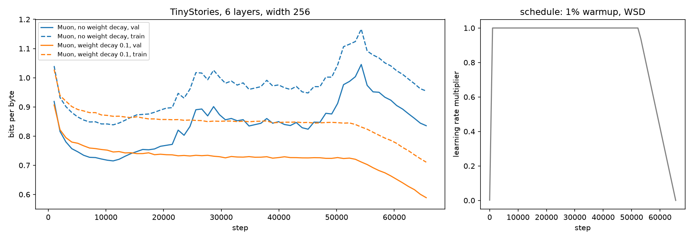

# 1.12 在完整的 TinyStories 上训练

第一章的收尾实验：用第一章选定的全部配置，把模型放大一些，在完整的 TinyStories 训练集上训练，看能训练到什么程度。这一节不展开分析模型结构，那是第二章的内容。

## 配置

| | 1.11 | 1.12 |
|---|---|---|
| 层数 / 宽度 / 头数 | 1 / 48 / 4 | **6 / 256 / 4**（每个头的维度 64，和主流模型一样） |
| 上下文 / 分词器 | 256 / bpe1024 | 不变 |
| 参数量 | 14 万 | **531 万**（Transformer 部分 478 万，embedding 和输出层 52 万） |
| 初始化 | N(0, 0.08²) | 不变 |
| 优化器 | Adam | **Muon**（Transformer 内部的矩阵）+ Adam（embedding、输出层） |
| 学习率调度 | 线性衰减 | **前 1% warmup，WSD**（最后 20% 线性降到 0） |
| batch / 步数 | 16 × 256 / 4096 | **64 × 256 / 65536** |
| 训练数据 | TinyStories 验证集文件的 90%，约 1700 万个 token | **完整训练集**：212 万个故事，6.2 亿个 token |
| 看过的 token | 1700 万 | **10.7 亿**（训练集约过 1.7 遍） |
| 精度、工程 | bf16 混合精度，编译 + CUDA Graph | 不变 |

参照的是 llama2.c 在 TinyStories 上训练的 15M 模型（6 层，宽度 288，上下文 256）。它的词表是 32000，我们的是 1024，所以参数少很多。

- **数据**：`prepare.py` 把训练集编码成 token。1.05 只存了词表，没存合并规则，所以先用和 1.05 完全相同的数据和步骤重新学一遍合并规则，并检查学出来的词表和 1.05 的逐个相同，再用 32 个进程并行编码，约 1 分钟。token 用 int16 存，整份放进显存约 1.2 GB。
- **验证集**还是之前那 500 个故事，结果可以和前面各节直接比。另外在训练集开头取同样多的窗口，用同样的方式评估。

## 扫学习率

学习率参数同时缩放两个优化器：Muon 用 `lr`，Adam 用 `lr / 2`。每个学习率训练 2048 步，其余和正式训练相同：

| lr | 0.005 | 0.01 | 0.02 | 0.04 | 0.08 |
|---|---|---|---|---|---|
| val bpb | 0.7606 | **0.7391** | 0.7529 | 发散 | 发散 |

正式训练用 0.01。

## 第一次：Muon 不加 weight decay

左：验证集（实线）和训练集固定窗口（虚线）的 bpb；右：学习率倍数。

| 步数 | 学习率倍数 | val bpb |
|---|---|---|
| 0 | warmup | 11.70 |
| 11264 | 1 | **0.7150**（最低点） |
| 24576 | 1 | 0.8330 |
| 52224 | 1 | 0.9873（最差） |
| 65536 | 0 | 0.8356（最终） |

训练用时 800 秒，峰值显存 2.2 GB。

- **最低点 0.715，比 1.11 的 1.18 低了 0.46。** 模型大了 38 倍，数据多了 60 多倍。
- **但学习率恒定的阶段走到第 1.2 万步以后，loss 一路上升**，到第 5.2 万步时 val bpb 回到 0.99。最后 20% 的衰减只救回来一部分，最终 0.836，还不如扫学习率时只训练 2048 步的 0.739。
- **开头的 val bpb 是 11.7**，比对 1024 个 token 均匀瞎猜的 3.2 差得多。6 层叠起来以后，初始化 0.08 让输出层一开始就很自信地猜错。几百步之内就恢复了。
- **训练集窗口的 bpb 一直比验证集高约 0.12。** 这不是过拟合：两边取的文本不同，难度本来就不一样，而且这个差距从头到尾基本不变。
- **生成的故事已经相当通顺**，语法基本正确，但情节还不太连贯：

> Once upon a time there was a little girl named Lily. One day, she went for a walk with her mommy. They saw a big tree with a needle. Lily wanted to climb it, but her mommy said no. Lily's mommy said, "It is too high for me!" ... Lily and her mommy went to the station to the hospital. They climbed the tree and climbed up the tree.

### 原因：参数越长越大

训练完把参数读出来看。初始化时所有矩阵的标准差都是 0.08，训练完：

| 矩阵 | 标准差 | 最大绝对值 |
|---|---|---|
| wte | 1.21 | 6.76 |
| 第 1 层 q、k | 0.51、0.48 | 2.5、2.7 |
| 第 1 层 MLP 第一层 | 0.99 | 7.13 |
| 第 6 层 q、k | **1.31、1.37** | 6.9、7.8 |
| 第 6 层 v、o | 0.67、0.45 | 3.1、2.5 |

第 6 层的 q、k 长大了 16 倍以上。注意力的 logit 是 q 和 k 的点积，两者各大 16 倍，logit 就大约 250 倍。softmax 变得非常尖锐，训练开始不稳定。

这正是 1.11 对照表里大模型遇到的问题：Muon 不加 weight decay，参数会越长越大（Moonlight 的研究），所以 Kimi、GLM、DeepSeek 都给 Muon 加了 0.1 的 weight decay；Kimi K2 还专门用 QK-Clip 压住注意力的 logit。在 1.10 那个 1 层、训练 4 秒的模型上，weight decay "没有用"；训练一变长、模型一变深，问题马上出现了。

## 第二次：Muon 加 weight decay 0.1

只改一处：Muon 加 weight decay 0.1，也就是每一步把矩阵乘上 (1 − 学习率 × 0.1)。这是 Kimi、GLM、DeepSeek 的做法。Adam 那部分（embedding、输出层）不加：`torch.optim.Adam` 的 weight decay 是 L2 的写法，1.10 里会让训练失败。

| 步数 | 学习率倍数 | 不加 weight decay | 加 weight decay 0.1 |
|---|---|---|---|
| 4096 | 1 | 0.756 | 0.779 |
| 11264 | 1 | **0.715** | 0.745 |
| 24576 | 1 | 0.833 | 0.732 |
| 52224 | 1 | 0.987 | 0.724 |
| 65536 | 0 | 0.836 | **0.589** |

表中是 val bpb。训练用时 775 秒，峰值显存 2.2 GB。

- **问题解决了。** 学习率恒定的阶段，val bpb 一路缓慢下降，再也没有回升。
- **前期反而慢一点**（第 11264 步时 0.745 对 0.715）。weight decay 每一步都在把参数往回拉，学得慢一些，和 1.10 里看到的一样。
- **最后 20% 的衰减带来了一大截**：从 0.724 降到 0.589，降了 0.135，占整个恒定段之后提升的绝大部分。这就是 1.07 里 WSD 的样子：恒定段积累，衰减段兑现。
- **最终 0.589，比 1.11 的 1.18 降了一半**，也比不加 weight decay 时的最低点 0.715 低了 0.13。
- **训练集窗口和验证集的差距仍然是约 0.12，从头到尾不变。** 数据过了 1.7 遍，仍然没有过拟合。

### 参数的大小

训练完的标准差（初始化时都是 0.08）：

| 矩阵 | 不加 weight decay | 加 weight decay 0.1 |
|---|---|---|
| 第 1 层 q、k | 0.51、0.48 | 0.059、0.054 |
| 第 1 层 MLP 第一层 | 0.99 | 0.041 |
| 第 6 层 q、k | 1.31、1.37 | 0.048、0.049 |
| 第 6 层 v、o | 0.67、0.45 | 0.039、0.034 |
| wte（Adam，两次都不加） | 1.21 | 0.98 |

加了 weight decay，Transformer 内部的矩阵都稳定在 0.03 到 0.06 之间，比初始化时还小；不加时长到了 0.5 到 1.4。embedding 用的是 Adam，两次都没加 weight decay，也都长到了 1 左右，但它不参与注意力的点积，影响小得多。

### 生成的故事

> Lily and Tom were twins who liked to play with their toys. One day, they found a big box in the living room. It had many buttons and lights and sounds. Lily and Tom wanted to see what was inside the box.
> "Let's open it and see," Tom said.
> "No, we can't," Lily said. "Mom said we have to wait for her."
> ...
> "No, I don't want to. It is my turn. I want to see what is inside," Tom said.
> They both pulled the box and saw a shiny thing. It was a ring.

对话有来有回，人物的动机前后一致，情节也能接上。和 1.11 那个 14 万参数的模型相比，已经是完全不同的水平。

## 小结

- **第一章的配置，放大到 531 万参数、10.7 亿个 token，13 分钟训练到 val bpb 0.589**，生成的故事基本通顺、连贯。
- **但必须给 Muon 加 weight decay。** 不加的话，参数越长越大，注意力的 logit 跟着变大，训练到一半就开始变差。
- 这正好印证了 1.11 里的判断：1.10 在玩具模型上得出的"weight decay 没有用"，换到更深的模型、更长的训练就不成立了。大模型给 Muon 加 weight decay，管的就是这件事。
