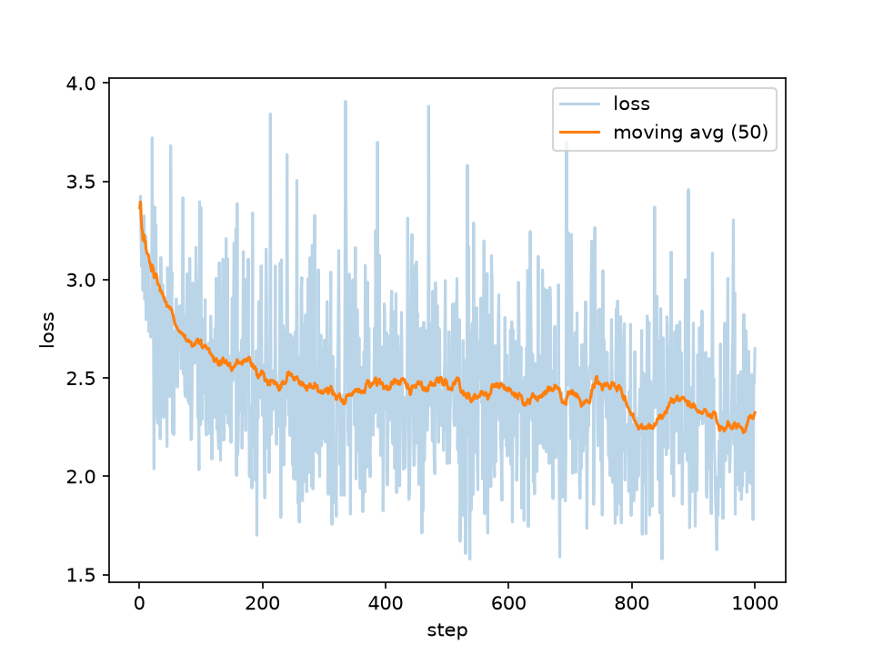

# 1.01 microgpt

[microgpt](https://gist.github.com/karpathy/8627fe009c40f57531cb18360106ce95) 是 Karpathy 用纯 Python 写的最简单的 GPT。大约 200 行，不依赖任何库，自己实现了自动求导、一层 Transformer、Adam 优化器和采样。它在一个名字数据集上训练，学着生成新的名字。

这一节原样跑通它，作为后面所有对比的起点。

## 观察

| | |
|---|---|
| 参数量 | 4192 |
| 训练量 | 1000 步，每步一个名字，共 7170 个 token |
| loss | 约 3.4 → 2.3（随机乱猜是 ln 27 ≈ 3.30） |
| 耗时 | 每步约 0.11 秒，共 109 秒（约 66 tokens/s） |

- 前 200 步下降很快，之后平在 2.4–2.5，最后 200 步随着学习率衰减到 0 又降了一点。
- 每步只看一个名字，单步 loss 抖动很大（约 ±0.7）。
- 生成的名字：kamon、karai、jaire、keylen、alerin、anton。
