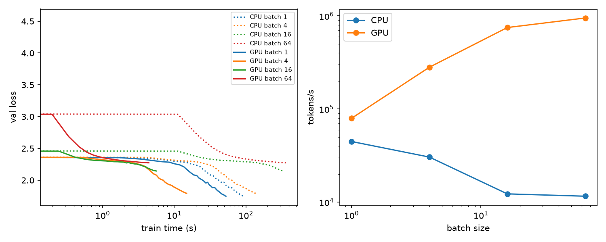

# 1.04 CUDA

把 1.03 的 TinyStories 训练搬到 GPU 上：参数和数据都放到 GPU，其他不变。batch 仍然在 CPU 上抽取，再拷到 GPU，所以和 1.03 用的数据完全相同。

计算仍然用 float64。这张卡的 float64 速度只有 float32 的 1/64，精度的影响留到 1.08 再看。

## 观察

| batch | val loss | CPU tokens/s（1.03） | GPU tokens/s | GPU 快多少 |
|---|---|---|---|---|
| 1 | 1.7483 | 44.9k | 79.5k | 1.8× |
| 4 | 1.7937 | 30.5k | 281.2k | 9.2× |
| 16 | 2.1452 | 12.3k | 750.4k | 61× |
| 64 | 2.2739 | 11.6k | 950.4k | 82× |

- **loss 和 1.03 完全一致**（精确到小数点后 4 位），这一节只改变了速度。
- **GPU 在 batch 小时受启动开销限制。** 每个训练步大约要启动 280 个 kernel，batch 从 1 增大到 16，每步耗时只从 3.2 ms 涨到 5.5 ms，所以 tokens/s 几乎随 batch 线性增长。到了 batch 64，GPU 基本一直在忙（每步 17 ms），速度开始受显存带宽限制，增长明显放缓。
- **CPU 正好相反：batch 越大越慢。** 主要原因是 malloc 在分配大块内存时的开销。
- **速度和 loss 之间有权衡。** 在 GPU 上，batch 64 只用 4.4 秒就训练完了，但同样的 token 数下更新次数少，停在 2.27；batch 4 用 15 秒到了 1.79。
- **batch 再往上加，吞吐也涨不上去了。** 单独测速时，batch 一直扫到 2048：吞吐在 batch 32 左右达到约 110 万 tokens/s，之后就不再变化，一直到 batch 3072 显存放不下。
- 详细的速度分析（硬件上限、MFU、时间花在哪里）见 [analysis/notes.md](analysis/notes.md)。
