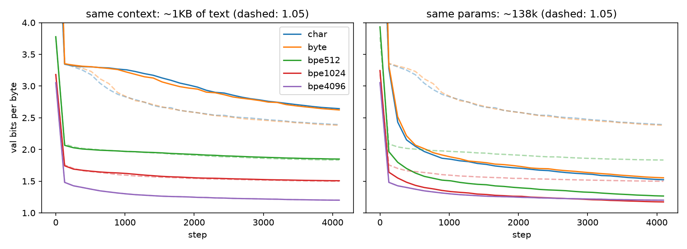

# 1.05 拆开 BPE 的优势

1.05 里 bpe4096 比 char 好很多，即使看到同样多的文本也是如此。但除了"切分方式不同"，还有两个因素混在里面：

1. **上下文的字节数不同。** 上下文都是 256 个 token，char 只能看到 256 个字节，bpe4096 能看到约 1KB，接近一整篇故事。
2. **参数量不同。** 词表越大，wte 和 lm_head 越大。char 只有 1.0 万参数，bpe4096 有 13.8 万。

这里做两组实验，每组只对齐其中一个因素，都向 bpe4096 看齐。其余设置和 1.05 相同（batch 16、4096 步、学习率 0.01）。每组单独改一个参数：第一组改 `block_size`，第二组改 `n_embd`（模型宽度，MLP 和每个头的维度跟着一起变）。

## 第一组：上下文字节数一致

把 `block_size` 调到约 1KB 文本，宽度不变。这样每一步看到的文本量也都一样（约 16KB）。

| tokenizer | 字节/token | block_size | 上下文字节 | 参数量（其中词表） | 看到的文本 | 时间 | 文本吞吐 | val bpb（1.05） |
|---|---|---|---|---|---|---|---|---|
| char | 1.00 | 256 → 1015 | 1015 | 2.2 万（0.3 万） | 66.5 MB | 228 s | 0.29 MB/s | 2.643（2.392） |
| byte | 1.00 | 256 → 1015 | 1015 | 2.8 万（0.8 万） | 66.5 MB | 233 s | 0.29 MB/s | 2.623（2.380） |
| bpe512 | 2.41 | 256 → 422 | 1016 | 2.6 万（1.6 万） | 66.6 MB | 56 s | 1.18 MB/s | 1.849（1.834） |
| bpe1024 | 3.16 | 256 → 321 | 1016 | 4.1 万（3.3 万） | 66.6 MB | 40 s | 1.67 MB/s | 1.507（1.498） |
| bpe4096 | 3.97 | 256 | 1015 | 13.8 万（13.1 万） | 66.5 MB | 60 s | 1.12 MB/s | 1.200（1.200） |

## 第二组：参数量一致

把 `n_embd` 加宽到总参数约 13.8 万，上下文仍是 256 个 token。宽度要能被 4 个头整除，所以 char 和 bpe512 只能对齐到 ±3% 以内。

| tokenizer | 字节/token | n_embd | 参数量（其中词表） | 上下文字节 | 看到的文本 | 时间 | 文本吞吐 | val bpb（1.05） |
|---|---|---|---|---|---|---|---|---|
| char | 1.00 | 16 → 92 | 14.1 万（1.6 万） | 256 | 16.8 MB | 33 s | 0.50 MB/s | 1.523（2.392） |
| byte | 1.00 | 16 → 80 | 13.8 万（4.1 万） | 256 | 16.8 MB | 33 s | 0.51 MB/s | 1.553（2.380） |
| bpe512 | 2.41 | 16 → 68 | 14.3 万（7.0 万） | 616 | 40.4 MB | 35 s | 1.14 MB/s | 1.266（1.834） |
| bpe1024 | 3.16 | 16 → 48 | 13.8 万（9.8 万） | 810 | 53.1 MB | 33 s | 1.60 MB/s | 1.173（1.498） |
| bpe4096 | 3.97 | 16 | 13.8 万（13.1 万） | 1015 | 66.5 MB | 60 s | 1.12 MB/s | 1.200（1.200） |

实线是这里的实验，虚线是 1.05 的原结果。

## 观察

- **上下文变长，char 反而变差。** 上下文从 256 加到 1015 个 token，char 从 2.39 变差到 2.64，前 1000 步一直卡在 3.3 左右。BPE 几乎不变。一个可能的原因：上下文越长越难训，模型容量又小（1 层、每个头 4 维），注意力分散在上千个位置上，很难学会盯住最近的几个字符。
- **所以 BPE 的好处不是"一个 block 里装下更多文本"。** 第一组里所有 tokenizer 的上下文和每步文本量都一样，BPE 还是领先很多，差距反而更大了（1.19 → 1.44）。好处在于每个 token 本身更有意义：不用逐字母拼写，同样的文本要预测的次数也更少。
- **参数量是 BPE 优势的大头。** 参数对齐后，char 从 2.39 降到 1.52，和 bpe4096 的差距从 1.19 缩小到 0.32，大约 70% 的差距消失了。BPE 的好处有一部分是靠词表参数堆出来的。
- **剩下的约 0.3 来自压缩比。** 参数一样多时，压缩比越高越好，char/byte → bpe512 → bpe1024 依次变好。这里每步都是 4096 个 token，压缩比高也意味着看到更多文本，这两点在这组里分不开。
- **参数一样多时，bpe1024 比 bpe4096 更好。** bpe4096 的参数 95% 都在词表上，模型本身只有 16 维；bpe1024 把更多参数留给了模型本身（48 维）。词表并不是越大越好，要和模型大小一起选。
- **速度：** 加宽后的 char 只要 33 秒，比 bpe4096 的 60 秒还快，因为不用在 4096 个词上算 softmax。拉长上下文则很贵，char 的时间涨到约 4 分钟，因为注意力的计算量和上下文长度的平方成正比。
