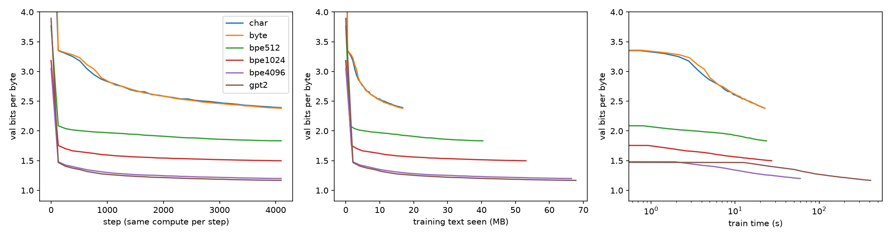

# 1.05 Tokenizer

之前的模型一个字符就是一个 token。这一节换成不同的 tokenizer，看看"怎么把文本切成 token"对训练有什么影响。

对比四种 tokenizer，每种对应 `tokenizers/` 里的一个脚本：

- **char**：一个字符一个 token，词表就是数据里出现过的 89 个字符。
- **byte**：一个 UTF-8 字节一个 token，词表 256 个，任何文本都能编码。
- **BPE**：从 256 个字节出发，反复把最常一起出现的两个 token 合并成一个新 token，直到词表达到指定大小（512、1024、4096）。合并前先按 GPT-2 的规则把文本切成词和标点，合并不会跨过词的边界。词表是在 TinyStories 上训练出来的，常见的词会变成一个 token，比如 ` farmer`、` frightened`、` celebrate`。
- **gpt2**：OpenAI 在网页文本上训练的 BPE，词表 50257 个。

不同 tokenizer 的 loss 不能直接比：同样一句话，char 要预测很多次，BPE 只要预测几次。所以统一换算成 **bits per byte（bpb）**，即平均每个字节的文本要用多少 bit 来编码，越低越好。

数据是 TinyStories（90% 训练，验证集固定为同样的 500 篇故事）。所有 tokenizer 用同样的设置：batch 16、上下文 256 个 token、4096 步、宽度 16。所以每一步的计算量大致相同（词表大小不同，lm_head 的计算量不同）。

## 观察

| tokenizer | 词表 | 字节/token | 参数量（其中词表） | 看到的文本 | val bpb | 训练时间 |
|---|---|---|---|---|---|---|
| char | 89 | 1.00 | 1.0 万（0.3 万） | 16.8 MB | 2.392 | 22 s |
| byte | 257 | 1.00 | 1.5 万（0.8 万） | 16.8 MB | 2.380 | 23 s |
| bpe512 | 512 | 2.41 | 2.4 万（1.6 万） | 40.4 MB | 1.834 | 24 s |
| bpe1024 | 1024 | 3.16 | 4.0 万（3.3 万） | 53.1 MB | 1.498 | 27 s |
| bpe4096 | 4096 | 3.97 | 13.8 万（13.1 万） | 66.5 MB | 1.200 | 60 s |
| gpt2 | 50257 | 4.04 | 161.5 万（160.8 万） | 67.8 MB | 1.169 | 409 s |

"字节/token"就是压缩比；"参数量"括号里是 wte 和 lm_head 的参数，它们随词表大小增长。

- **BPE 的提升非常大。** 同样的步数，bpe4096 的 bpb 只有 char 的一半。生成的文字也从 `limed and the and saided ig the toy...` 变成了 `One day, a little boy named Tim went to...`，基本能读了。
- **char 和 byte 几乎一样。** TinyStories 基本是英文，几乎没有多字节字符。
- **词表越大越好，但收益递减。** 512 → 1024 → 4096，bpb 依次是 1.83、1.50、1.20。
- **gpt2 和 bpe4096 差不多，代价却大得多。** 两者压缩比几乎相同，gpt2 只好 0.03，参数却多 12 倍，耗时多 7 倍。bpe4096 是在 TinyStories 上训练的，正好贴合这类文本；gpt2 的 5 万个词大多是为网页文本准备的，这里用不上，却每一步都要在 5 万个词上算 softmax。
- **即使看到同样多的文本，BPE 也更好（中图）。** 所以 BPE 的好处不只是"每一步多看了一些字"。但这里还混着另外两个因素：BPE 的上下文按字节算更长，参数也更多。在 [analysis/notes.md](analysis/notes.md) 里把它们拆开看了：上下文长度几乎没有贡献；参数量是大头；剩下的部分来自 tokenization 本身。
- **速度：** 词表在 1024 以下时，时间主要花在注意力上，训练时间基本不变。词表再大，lm_head 和 softmax 的开销开始占主导，gpt2 的时间几乎全花在这上面。
- **词表大小要和模型大小一起选。** 宽度固定为 16 时，bpe4096 最好；但如果参数总量一样，bpe1024 搭配更宽的模型反而更好（见 analysis）。
