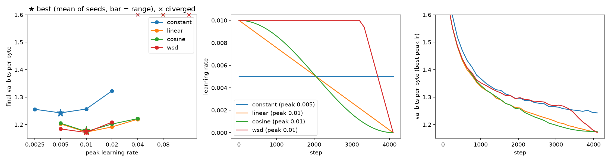
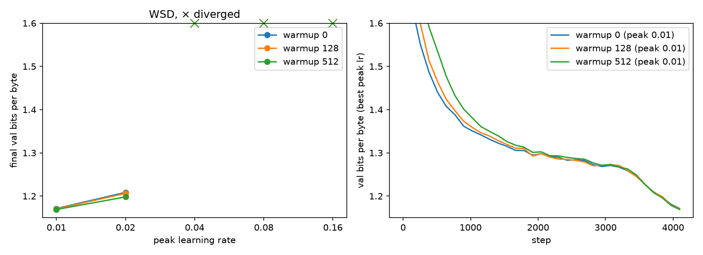
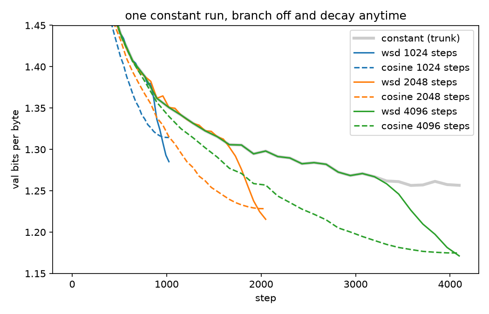

# 1.07 学习率调度

之前一直用线性衰减。这一节比较不同的学习率调度：衰减的形状（constant、linear、cosine、WSD），以及开头要不要 warmup。每种调度在 `schedules/` 里一个文件，warmup 在 `train.py` 里统一乘在前面。为什么要衰减、为什么要 warmup、在大模型中的情况，见 [schedules/README.md](schedules/README.md)。

优化器固定为 Adam（1.06 的结果里 Muon 更好，但大模型的调度经验大多来自 AdamW，用 Adam 更好对照）。其余设置和 1.06 相同：bpe1024、宽度 48、上下文 256、batch 16、4096 步、float64。所有调度都衰减到 0。

分三组：

1. **衰减的形状**：不加 warmup，每种调度单独扫峰值学习率，在最佳点上再换 2 个种子。
2. **warmup**：衰减形状固定为 WSD，warmup 取 0、128、512 步，每种都把峰值学习率扫到发散为止。
3. **WSD 随时可停**：训练 1024、2048、4096 步，对比 WSD 和 cosine。

## 第一组：衰减的形状

| 调度 | 0.0025 | 0.005 | 0.01 | 0.02 | 0.04 | 0.08 |
|---|---|---|---|---|---|---|
| constant | 1.2557 | **1.2425** | 1.2566 | 1.3227 | 第 1315 步发散 | 第 11 步发散 |
| linear | | 1.2023 | **1.1727** | 1.1913 | 1.2194 | 第 11 步发散 |
| cosine | | 1.2050 | **1.1748** | 1.2019 | 1.2216 | 第 11 步发散 |
| wsd | | 1.1842 | **1.1713** | 1.2086 | 第 1315 步发散 | 第 11 步发散 |

表中是种子 42 的结果。在最佳学习率上换 3 个种子：

| 调度 | 最佳峰值 lr | val bpb（3 个种子的均值） | 3 个种子的范围 |
|---|---|---|---|
| constant | 0.005 | 1.2418 | 1.2390 ~ 1.2439 |
| linear | 0.01 | 1.1757 | 1.1727 ~ 1.1778 |
| cosine | 0.01 | 1.1783 | 1.1748 ~ 1.1819 |
| **wsd** | 0.01 | **1.1742** | 1.1713 ~ 1.1788 |

左图：横轴是峰值学习率，纵轴是最终的 val bpb，★ 是最佳点（竖线是 3 个种子的范围），图顶部的 × 表示发散。中图：最佳峰值下学习率随步数的变化。右图：对应的 loss 曲线。

- **只要衰减到 0，形状影响不大。** linear、cosine、WSD 相差不到 0.005，种子之间的范围互相重叠，算打平。
- **不衰减明显更差。** constant 比它们差 0.07。而且它的最佳学习率只有 0.005，是其他调度的一半：没有衰减，只能靠小学习率压低噪声。
- **WSD 的收益都在最后 20%。** 前 80% 它和 constant 是同一条曲线，loss 一直更高；进入衰减段以后迅速下降，反超 linear 和 cosine。学习率 0.01 的 constant 从第 3072 步到最后只降了 0.014，WSD 同一段降了 0.10。
- **学习率 0.04 时，constant 和 WSD 在同一步（第 1315 步）发散，linear 和 cosine 却能跑完。** WSD 那时还在 stable 段，和 constant 完全一样；而 linear 和 cosine 的学习率到第 1315 步已经降到约 0.027 和 0.030。也就是说，0.04 在开头是稳定的，训练了上千步以后才不稳定。
- **0.08 对所有调度都在第 11 步发散**：开头的学习率都一样，衰减形状还没来得及起作用。

## 第二组：warmup

| warmup 步数 | 0.01 | 0.02 | 0.04 | 0.08 | 0.16 |
|---|---|---|---|---|---|
| 0 | 1.1713 | 1.2086 | 第 1315 步发散 | 第 11 步发散 | 第 3 步发散 |
| 128 | 1.1702 | 1.2064 | 第 791 步发散 | 第 101 步发散（lr 升到 0.063） | 第 58 步发散（0.073） |
| 512 | **1.1690** | 1.1980 | 第 1457 步发散 | 第 406 步发散（0.063） | 第 201 步发散（0.063） |

均为种子 42、WSD 衰减形状。括号里是发散时 warmup 已经把学习率升到了多少。

左图：峰值学习率和最终 val bpb，× 表示发散。右图：每种 warmup 在最佳峰值下的 loss 曲线。

- **warmup 几乎没有作用。** 最好的结果只好了 0.002，比种子之间的波动还小。三条 loss 曲线几乎重合。
- **warmup 没有让更大的学习率变得可用。** 加了 warmup，0.08 和 0.16 不再在开头就发散；但学习率一升到 0.063 到 0.073，还是会发散，和 warmup 长短无关。不加 warmup 时，0.04 在开头稳定，0.08 在第 11 步发散，所以开头能承受的学习率一直在 0.04 到 0.08 之间。
- **0.04 不管加不加 warmup，都在训练中途发散**（第 791 到 1457 步），这时 warmup 早已结束。
- 为什么 warmup 没用：我们的模型是 Pre-LN（每个子层之前先做 rmsnorm），Adam 又有 bias correction，两个"需要 warmup"的主要原因在这里都不存在（Xiong et al. 2020；Liu et al. 2019）。限制峰值学习率的是训练中途的不稳定，warmup 管不到。这可能是 edge of stability：训练过程中 loss 地形逐渐变陡，直到当前学习率承受不了（Cohen et al. 2021）。我们没有测量 sharpness，这只是推测。

## 第三组：WSD 随时可停

WSD 训练 $N$ 步时，前 80% 就是 constant。同一个种子下，不同 $N$ 的 WSD 在衰减之前是同一条曲线，相当于从一条 constant 主干上分出不同的分支去衰减。cosine 的每一步都取决于 $N$，每个长度只能从头训练。峰值学习率都用 0.01。

| 训练长度 | WSD | cosine | 差距 |
|---|---|---|---|
| 1024 步 | **1.2852** | 1.3144 | 0.029 |
| 2048 步 | **1.2156** | 1.2283 | 0.013 |
| 4096 步 | **1.1713** | 1.1748 | 0.004 |

灰色粗线是 constant 主干，实线是不同长度的 WSD，虚线是不同长度的 cosine。

- **WSD 的分支和主干完全重合**，直到各自的最后 20% 才分开、迅速下降。
- **每个长度上，WSD 都比从头训练的 cosine 好**，训练越短，优势越大。
- **训练过程中，cosine 一直更低，但最终是 WSD 更低。** 比较不同调度时只能看最后的结果，中途的 loss 没有意义。
- **计算量更少。** 想拿到这三个长度的模型，WSD 一共约 4700 步（主干 4096 步，加上 1024 步和 2048 步两个分支各自的衰减段），cosine 要 1024 + 2048 + 4096 = 7168 步。
- 注意：短的训练也用了峰值 0.01，没有单独调学习率。

**生成的文字**（WSD，4096 步）：`Once upon a time, there was a little girl named Lily. She had a toy castle. She loved to play with her friends. One day, Lily saw a big tree...`

## 和大模型训练的对照

详细内容和出处见 [schedules/README.md](schedules/README.md)，这里只列结论：

- **一致的地方：**
  - 一定要衰减。只要最终降到 0，形状影响不大，WSD 能追平 cosine（Hägele et al. 2024）。
  - WSD 不需要事先定下训练长度，同一条主干可以分出任意长度的模型。大模型越来越多地采用这个思路：MiniCPM、SmolLM3 直接用 WSD；DeepSeek-V3 前 10T token 学习率不变，之后才开始衰减。
  - 衰减段的 loss 下降特别快。大模型正是利用这一点，在衰减段换上最高质量的数据（MiniCPM、Llama 3、OLMo 2）。
- **不一致的地方：**
  - **warmup：** 大模型几乎都加几千步 warmup，我们这里几乎没用。这和 Pre-LN + Adam 的理论一致。大模型的 batch、学习率更大，又用 bf16，一次发散的代价极高，而几千步 warmup 只占总训练的不到 1%，是一份便宜的保险。
  - **最低学习率：** GPT-3、LLaMA 只降到峰值的 10%，我们降到 0。Bergsma et al. (2025) 认为降到 0 更好，Llama 3 和 OLMo 2 最后也都降到了 0。
