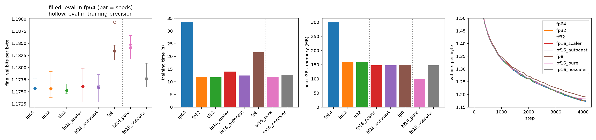
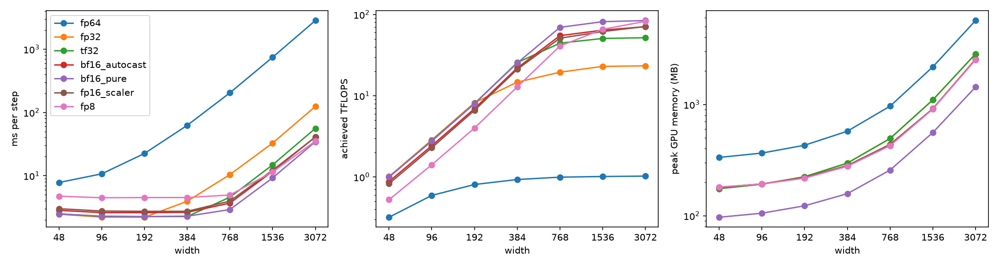

# 1.08 数据精度

1.02 到 1.07 一直用 fp64（64 位浮点数）训练。这一节比较：**训练里的各类数——参数、梯度、优化器状态、矩阵乘法、激活——各用多少位来存、来算**，对 loss、速度、显存有什么影响。

每种精度在 `precisions/` 里一个文件。浮点数怎么表示、各种方案在做什么、论文是怎么选的，见 [precisions/README.md](precisions/README.md)。这里只简单解释用到的几个名词：

- **混合精度**：不同的数用不同的精度。常见的做法是参数留 fp32，只把计算量最大的矩阵乘法换成 16 位来算。
- **主副本**：混合精度里，参数的那份 fp32 原件。更新都加在它上面，算的时候再临时转出一份 16 位的副本。
- **autocast**：PyTorch 的自动转换开关。在它的代码块里，矩阵乘法自动用 16 位算，exp、求和这类对精度敏感的运算自动用 fp32 算。
- **loss scaling**：fp16 能表示的最小的数不够小，很小的梯度会变成 0（**下溢**）。所以反向传播前先把 loss 放大几万倍，梯度跟着放大，更新前再缩回去。PyTorch 里做这件事的工具叫 GradScaler，文件名里的 **scaler** 指的就是它。
- **fp8 的缩放**：fp8 能表示的范围太窄，转格式前要先把整个张量乘一个系数（缩放因子），挤进 fp8 的范围，用完再除回去。

设置和 1.07 相同：bpe1024、宽度 48、上下文 256、batch 16、4096 步、Adam 学习率 0.01 线性衰减、不加 warmup。优化器和学习率调度在 1.06、1.07 已经对比过，从这一节开始直接用 PyTorch 自带的（`torch.optim.Adam`、`LambdaLR`），不再手写。

## 实验设计

8 种设置分三组：

| 组 | 文件 | 参数 | 梯度、优化器状态 | 矩阵乘法 | 其他运算 |
|---|---|---|---|---|---|
| **基线** | `fp64` | fp64 | fp64 | fp64 | fp64 |
| | `fp32` | fp32 | fp32 | fp32 | fp32 |
| | `tf32` | fp32 | fp32 | tf32（硬件开关：输入输出仍是 fp32，内部截短尾数来算） | fp32 |
| **论文路线** | `fp16_scaler` | fp32 主副本 | fp32 | fp16，加 loss scaling | autocast 决定 |
| | `bf16_autocast` | fp32 主副本 | fp32 | bf16 | autocast 决定 |
| | `fp8` | fp32 主副本 | fp32 | 层内 6 个线性层用 fp8，lm_head 和注意力用 bf16 | autocast 决定 |
| **消融** | `bf16_pure` | **bf16，没有主副本** | bf16 | bf16 | bf16 |
| | `fp16_noscaler` | fp32 主副本 | fp32 | fp16，**不加 loss scaling** | autocast 决定 |

- **基线**：所有数用同一种格式，只是位数不同。
- **论文路线**：fp16 混合精度（Micikevicius et al. 2018）→ bf16 混合精度（现在的标准）→ fp8（DeepSeek-V3 的简化版）。
- **消融**：从论文的方案里去掉一个部件，看它是不是真的必要。去掉主副本，对应 Gopher 附录里的实验；去掉 loss scaling，对应 Micikevicius 的实验。

我们的 fp8 和 DeepSeek-V3 有三处不同：用整个张量一个缩放因子，而不是分块缩放；梯度用 E5M2 格式而不是 E4M3；Adam 状态和激活没有降低精度。

**评估：** 训练过程中，用训练时的精度评估。训练结束后，再把参数转成 fp64，去掉 autocast 和 fp8，重新评估一次。后者只反映"训练出来的权重好不好"，两者之差就是推理时的精度损失。

每种设置跑 3 个种子。

## 结果

从左到右：
1. 最终 val bpb：实心点是 fp64 评估（竖线是 3 个种子的范围），空心点是用训练时的精度评估；
2. 训练时间；
3. 显存峰值；
4. loss 曲线（种子 42）。

虚线把三组分开。

### 第一组：基线

| 精度 | val bpb（3 个种子） | 种子范围 | 训练时间 | 显存峰值 |
|---|---|---|---|---|
| fp64 | 1.1757 | 1.1727 ~ 1.1778 | 33.4 s | 299 MB |
| fp32 | 1.1756 | 1.1738 ~ 1.1792 | 11.8 s | 159 MB |
| tf32 | 1.1753 | 1.1746 ~ 1.1766 | 11.8 s | 159 MB |

- **fp32 和 fp64 的结果一样，但快 2.8 倍、显存减半。** fp64 的精度远远超出训练的需要。
- **tf32 和 fp32 一样。** 在当前模型上也不更快，因为矩阵太小，时间不在矩阵乘法上（见第二部分）。

### 第二组：论文路线

| 方案 | val bpb（fp64 评估） | 种子范围 | 用训练时的精度评估 | 训练时间 | 显存峰值 |
|---|---|---|---|---|---|
| fp32（对照） | 1.1756 | 1.1738 ~ 1.1792 | 1.1756 | 11.8 s | 159 MB |
| fp16 混合 + loss scaling | 1.1761 | 1.1729 ~ 1.1798 | 1.1761 | 14.0 s | 148 MB |
| bf16 混合 | 1.1758 | 1.1729 ~ 1.1785 | 1.1761 | 12.5 s | 148 MB |
| fp8（简化版） | **1.1834** | 1.1816 ~ 1.1846 | **1.1893** | 21.6 s | 149 MB |

- **fp16 和 bf16 混合精度都没有损失**，和 fp32 在种子波动以内。
- **fp8 损失 0.008，推理时再损失 0.006。** 从 loss 曲线看，fp8 从训练开始就比 fp64 高 0.01 以上，一直到最后，和学习率大小无关。fp8 只有 3 位尾数，前向计算本身就不准。
- **这一组在当前模型上都比 fp32 慢。** 每多一步处理，就要在 GPU 上多启动一个 kernel（GPU 上执行的一个小程序），而当前模型的时间本来就全花在启动 kernel 上：
  - loss scaling 每步都要检查梯度有没有溢出；
  - autocast 要在 fp32 和 16 位之间来回转换；
  - fp8 每次矩阵乘法前，都要先求最大值、缩放、转格式。
- **显存几乎没省**，只比 fp32 少约 7%。参数、梯度、Adam 状态都还是 fp32，还要多存一份 16 位副本，省下的只有一部分激活。

### 第三组：消融

| 方案 | 去掉了什么 | val bpb（fp64 评估） | 种子范围 | 用训练时的精度评估 | 训练时间 | 显存峰值 |
|---|---|---|---|---|---|---|
| bf16 混合（对照） | — | 1.1758 | 1.1729 ~ 1.1785 | 1.1761 | 12.5 s | 148 MB |
| 纯 bf16 | fp32 主副本 | **1.1841** | 1.1818 ~ 1.1866 | 1.1846 | 11.9 s | **98 MB** |
| fp16 混合（对照） | — | 1.1761 | 1.1729 ~ 1.1798 | 1.1761 | 14.0 s | 148 MB |
| fp16 不加 loss scaling | loss scaling | 1.1777 | 1.1759 ~ 1.1809 | 1.1777 | 12.7 s | 148 MB |

- **去掉 fp32 主副本：变差 0.008，主副本是必要的。**
  - 用 bf16 评估和用 fp64 评估同一组权重，只差 0.0005，所以不是前向不准，而是训练时出了问题。
  - 和 fp64 的差距，前 3000 步只有 0.003 以内，最后 1000 步拉大到 0.010。学习率越小，每步的更新越小，越容易小于 bf16 能分辨的最小间距而被舍入掉，加不到参数上（见 README 第 2 节）。
  - 这和 Gopher 附录的结论一致。
  - 代价是换来了真正的显存减半（98 MB），因为所有数都是 16 位了。
- **去掉 loss scaling：在我们这里影响不明显。**
  - 不放大时，矩阵参数的梯度里有约 12% 下溢成了 0；放大以后只剩 0.03%。
  - 结果只差 0.0016，两者的种子范围大部分重叠。我们的模型小、梯度规整，下溢掉的只是本来就很小的那部分。
  - 加了 loss scaling 时，放大倍数从 65536 涨到 262144，一次都没有溢出。
  - 大模型上不是这样：fp16 时期，即使有 loss scaling，大模型也经常不稳定，这是 bf16 取代 fp16 的主要原因。

**生成的文字**（fp16 混合精度）：和 fp64 训练的模型看不出区别，比如 `Lucy was so happy and thanked her helping the ball. She climbed up and started to play with her friends. They all had a great day.`

## 第二部分：加宽模型，只测速度

当前模型太小，时间都花在 kernel 启动上，精度对速度的影响看不出来（见 [1.04 的分析](../1.04_cuda/analysis/notes.md)）。所以另写了 `analysis/speed.py`：模型、优化器、精度的处理和 `train.py` 相同，用随机权重，宽度从 48 加到 3072，每个组合只跑至少 1 秒来测速度。

下表每格是"每步毫秒数 / 实际达到的 TFLOPS"。TFLOPS 是每秒做多少万亿次浮点运算，衡量算力用满了多少。完整数据见 `out/1.08_precision/analysis/speed.csv`。

| 宽度 | fp64 | fp32 | tf32 | fp16 混合 | bf16 混合 | fp8 | 纯 bf16 |
|---|---|---|---|---|---|---|---|
| 48 | 7.8 / 0.3 | 2.5 / 1.0 | 2.5 / 1.0 | 3.0 / 0.8 | 2.8 / 0.9 | 4.8 / 0.5 | 2.5 / 1.0 |
| 384 | 62 / 0.9 | 4.0 / 15 | 2.3 / 26 | 2.7 / 21 | 2.6 / 22 | 4.5 / 13 | 2.3 / 25 |
| 768 | 204 / 1.0 | 10.4 / 19 | 4.6 / 44 | 4.0 / 51 | 3.7 / 55 | 5.0 / 41 | 2.9 / **69** |
| 1536 | 744 / 1.0 | 33 / 23 | 14.9 / 51 | 12.2 / 62 | 11.7 / 64 | 11.5 / 66 | 9.2 / **82** |
| 3072 | 2831 / 1.0 | 124 / 23 | 56 / 52 | 41 / 71 | 41 / 71 | 35 / 82 | 34 / **84** |

左：每步耗时；中：实际达到的 TFLOPS；右：显存峰值。

- **三个区间。**
  - **宽度 192 以下**：除 fp64 以外，所有精度都是两三毫秒一步，几乎不随宽度变化，时间全花在启动 kernel 上。多启动 kernel 的方案（loss scaling、fp8）反而更慢。
  - **宽度 384 到 768**：开始拉开差距。fp32 先跟不上，接着 tf32 和 16 位格式也依次变慢。
  - **宽度 1536 以上**：各精度都达到了自己的上限，速度大致按"格式越短越快"排好。
- **fp64 从宽度 192 起就卡在约 1 TFLOPS**，这已经是这块卡 fp64 的上限。宽度 3072 时，fp64 每步要 2.8 秒，纯 bf16 只要 34 毫秒，差约 82 倍。之前一直用的 fp64，放到大一点的模型上是不可行的。
- **fp32 卡在约 23 TFLOPS，tf32 约 52**，翻了一倍多，只需要一行设置。
- **bf16 混合精度 71 TFLOPS，纯 bf16 84 TFLOPS。** 纯 bf16 快 19%，因为 autocast 每次矩阵乘法前都要把 fp32 的参数转成 bf16 副本，激活也要在两种格式之间来回转。
- **fp8 没有达到预期：** 宽度 3072 时只比 bf16 混合精度快 16%，和纯 bf16 差不多。单独测矩阵乘法时，fp8 是 bf16 的 2.4 倍（4096×4096 时 255 对 105 TFLOPS），但放到整个训练里，加速被摊薄了：
  - 只有 6 个线性层用了 fp8，lm_head 和注意力仍是 bf16；
  - 每次量化都要先求最大值、再缩放、再转格式，反向还要为转置再存一份；
  - 这些步骤各自是一个 kernel，没有和矩阵乘法合并成一个。
- **显存：** 纯 bf16 始终是其他方案的一半左右。混合精度只比 fp32 省一点。fp8 和 bf16 混合精度差不多，因为我们没有把存给反向用的激活降成 fp8。

## 和大模型训练的对照

详细内容和出处见 [precisions/README.md](precisions/README.md)，这里只列结论。

**一致的地方：**
- bf16 混合精度和 fp32 训练效果一样（Kalamkar et al. 2019），是现在大模型训练的标准。
- fp32 主副本是必要的。Gopher 的附录发现，即使用随机舍入（按比例随机向上或向下取整），bf16 参数也不如保留一份 fp32 主副本。
- fp8 训练有精度损失，需要额外的手段来弥补。

**不一致的地方，主要来自规模：**
- **速度：** 大模型的矩阵足够大，低精度直接带来成倍的加速；我们的模型太小，低精度反而更慢。
- **loss scaling：** 大模型用 fp16 时，即使有 loss scaling，也经常发散（比如 BLOOM 早期的 104B 模型）；我们的模型不放大 loss 都没问题。
- **fp8：** 我们用整个张量一个缩放因子，损失 0.008，加速也有限。DeepSeek-V3 的做法是：
  - 分块缩放，激活每 1×128 个数一个缩放因子，权重每 128×128 块一个，这样少数特别大的数（离群值）只影响自己那一小块；
  - 提高累加的精度；
  - 写和矩阵乘法融合在一起的 kernel。

  他们的 loss 相对误差小于 0.25%，在 671B 的模型上验证了 fp8 训练可行。
