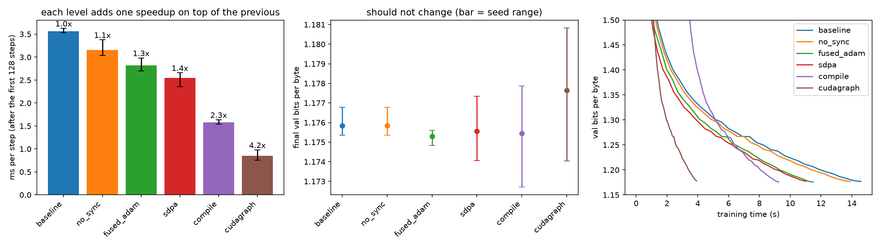
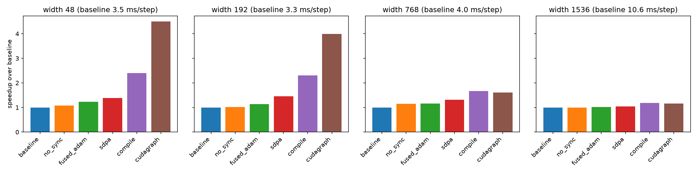

# 1.09 工程加速

数学不变，只追求快。工程上的加速一项一项往上叠，看每一项快了多少；loss 应该不变。每一项在做什么、解决的是哪种慢，见 [README.md](README.md)。这里只简单解释用到的几个名词：

- **kernel**：GPU 上的一个小程序。每做一次运算（加法、exp、矩阵乘法……），CPU 都要启动一个 kernel，每次启动要花几到十几微秒。
- **同步**：CPU 停下来，等 GPU 把排队的活干完。比如 `loss.item()` 要把 GPU 上的数取回来，就必须等。
- **融合**：把几个连续的小运算写成一个 kernel，少启动几次，中间结果也不用写进显存再读出来。
- **CUDA Graph**：把一整步训练的所有 kernel 录下来，之后每一步只发一条"重放"的指令。
- **profiler**：PyTorch 自带的性能分析工具，能数出一步里启动了多少个 kernel。

设置：bpe1024、宽度 48、上下文 256、batch 16、4096 步、Adam 学习率 0.01 线性衰减，精度用 1.08 选定的 bf16 混合精度。

## 实验设计

`train.py <level>`，每一级都在前一级的基础上再打开一项：

| 级别 | 打开什么 | 怎么做 |
|---|---|---|
| `baseline` | 什么都不加 | 每步 `loss.item()`；在 CPU 上拼好 batch 再拷到 GPU |
| `no_sync` | 减少同步 | loss 留在 GPU 上累加，每 128 步才取一次；训练数据整份放进显存，每步只传 16 个起点 |
| `fused_adam` | fused 优化器 | `Adam(fused=True)`，整个更新一个 kernel |
| `sdpa` | 内置注意力 | `F.scaled_dot_product_attention`，实际用的是 FlashAttention |
| `compile` | 编译 | `torch.compile` 编译前向和反向 |
| `cudagraph` | CUDA Graph | `torch.compile(mode='reduce-overhead')` |

- **计时**：只算两次评估之间的训练时间，读时间前先等 GPU 把排队的活干完。前 128 步单独记，因为打开 compile 时，这段时间包含编译；每步耗时只算之后稳定下来的部分。
- **数据顺序**：每一级看到的 batch 完全一样，loss 曲线可以直接对比。
- 每一级跑 3 个种子。

另外 `analysis/speed.py` 用同样的代码，在宽度 48 到 1536 上只测速度，并用 profiler 数宽度 48 时每步的 kernel 数和 CPU 启动调用次数。

## 第一部分：当前模型

| 级别 | 每步耗时（3 个种子） | 种子范围 | 累计加速 | 这一级的加速 | val bpb | 种子范围 | 显存峰值 | kernel 数 / CPU 启动次数 |
|---|---|---|---|---|---|---|---|---|
| baseline | 3.56 ms | 3.53 ~ 3.63 | 1.0× | — | 1.1758 | 1.1753 ~ 1.1768 | 148 MB | 269 / 255 |
| + no_sync | 3.15 ms | 3.04 ~ 3.38 | 1.13× | 1.13× | 1.1758 | 1.1753 ~ 1.1768 | 196 MB | 273 / 261 |
| + fused_adam | 2.82 ms | 2.70 ~ 2.98 | 1.26× | 1.12× | 1.1753 | 1.1748 ~ 1.1756 | 196 MB | 212 / 200 |
| + sdpa | 2.55 ms | 2.36 ~ 2.66 | 1.40× | 1.11× | 1.1756 | 1.1741 ~ 1.1773 | 172 MB | 190 / 180 |
| + compile | 1.58 ms | 1.54 ~ 1.64 | 2.25× | 1.61× | 1.1754 | 1.1727 ~ 1.1779 | 99 MB | 85 / 83 |
| + cudagraph | **0.85 ms** | 0.75 ~ 0.98 | **4.19×** | 1.86× | 1.1776 | 1.1740 ~ 1.1808 | 99 MB | 97 / **12** |

左：每步耗时（竖线是 3 个种子的范围），柱子上是相对 baseline 的加速比。中：最终 val bpb。右：loss 曲线（种子 42），横轴是训练时间。

- **loss 不变。** 6 级的种子范围全部重叠。`no_sync` 和 baseline 的结果一模一样，因为算的东西完全相同，只是 CPU 什么时候去取 loss 不同。其他级别的结果有微小差别，因为融合、FlashAttention 改变了浮点运算的顺序，舍入误差不同。
- **一共快了 4.2 倍，大头在 compile 和 CUDA Graph，两者合计 3 倍。**
- **baseline 的时间几乎全花在 CPU 启动 kernel 上。** 每步启动 255 次，耗时 3.56 毫秒，平均每次约 14 微秒，正好是启动一个 kernel 的典型开销。
- **compile 把 kernel 从 190 个融合到 85 个**，显存也从 172 MB 降到 99 MB：融合以后，很多中间结果不再写进显存；有些在反向时重新算一遍，比存着更划算。
- **CUDA Graph 的 kernel 数没有减少（97 个），但 CPU 启动调用从 83 次降到 12 次。** 省下的时间全在 CPU 那一侧。
- **减少同步只快了 13%。** 瓶颈在 CPU 发指令，GPU 早就算完在等，`loss.item()` 几乎不用等。只有 GPU 是瓶颈时，同步才真正浪费时间。代价是训练数据放进显存，多占 48 MB。
- **fused Adam 少了 57 个 kernel**，快了 12%。
- **SDPA 少了 22 个 kernel**，注意力矩阵也不用存了（196 → 172 MB），快了 11%。
- **编译要花时间。** compile 这一级前 128 步用了 3.1 秒（其他级别约 0.5 秒），右图里紫色的线起步晚，就是这个原因。编译结果会缓存，之后的运行（包括 cudagraph 这一级）只多花不到 0.5 秒。
- **cudagraph 的速度波动最大**（0.75 到 0.98 毫秒）。每步不到 1 毫秒，又完全受 CPU 限制，机器上其他进程占用 CPU 时，影响就很明显。

## 第二部分：加宽模型，只测速度

每格是每步毫秒数，括号里是相对 baseline 的加速比。完整数据见 `out/1.09_engineering/analysis/speed.csv`。

| 宽度 | baseline | + no_sync | + fused_adam | + sdpa | + compile | + cudagraph |
|---|---|---|---|---|---|---|
| 48 | 3.51 | 3.25 (1.08×) | 2.85 (1.23×) | 2.53 (1.39×) | 1.46 (2.40×) | **0.78 (4.50×)** |
| 192 | 3.27 | 3.22 (1.02×) | 2.88 (1.14×) | 2.25 (1.45×) | 1.42 (2.30×) | **0.82 (4.00×)** |
| 768 | 3.99 | 3.47 (1.15×) | 3.42 (1.17×) | 3.04 (1.31×) | **2.39 (1.67×)** | 2.48 (1.61×) |
| 1536 | 10.63 | 10.68 (1.00×) | 10.38 (1.02×) | 10.24 (1.04×) | **9.01 (1.18×)** | 9.20 (1.16×) |

每个宽度一张图，纵轴是相对 baseline 的加速比。

- **宽度 192 以下**：baseline 都是约 3.3 毫秒，几乎不随宽度变化，仍然是 CPU 启动 kernel 的瓶颈。全部打开以后快 4 倍以上。
- **宽度 768**：GPU 的计算开始变得重要。CUDA Graph 已经没有帮助，compile 的融合还有用，全部加起来快 1.6 倍。
- **宽度 1536**：时间主要花在矩阵乘法上，GPU 成了瓶颈。减少同步、fused、SDPA 几乎都没用，只剩 compile 的融合（少读写显存）还能快 18%。
- 这和 1.04、1.08 的结论是一回事：**小模型慢在 CPU 启动 kernel，大模型慢在 GPU 计算本身**，两种情况要用不同的办法加速。

**一个测量上的坑：** 最初 `speed.py` 每测完一级，就马上用 profiler 数一次 kernel。结果发现，profiler 运行过一次以后，同一个进程里之后的每一步都会一直慢约 20%（同一个 sdpa，2.54 毫秒变成 3.05 毫秒）。改成先测完所有速度、最后再数 kernel 以后，两部分的结果才对上。**测速度时，profiler 不能和计时放在同一个进程的同一段里。**

## 和大模型训练的对照

详细内容见 [README.md](README.md) 第 8、9 节，这里只列结论。

- **一致的地方：** 这几项在大模型训练中几乎都是标配。nanoGPT 用了 bf16 autocast、`torch.compile`、SDPA（FlashAttention）、fused AdamW、锁页内存加非阻塞拷贝，和这一节的内容几乎一一对应。它们代价很小，又不改变数学。
- **不一致的地方：** 在大模型里，这几项带来的加速远没有我们这么大。我们的 4 倍主要来自减少 CPU 启动 kernel 的开销，而大模型的瓶颈在 GPU 计算和多卡通信，就像宽度 1536 时只剩 1.2 倍。大模型真正的速度来自更高效的矩阵乘法 kernel、通信和并行，留到 infra 章再讲。FlashAttention 是个例外：它在大模型里的主要价值是让长上下文的注意力不再占用 $O(T^2)$ 的显存。
