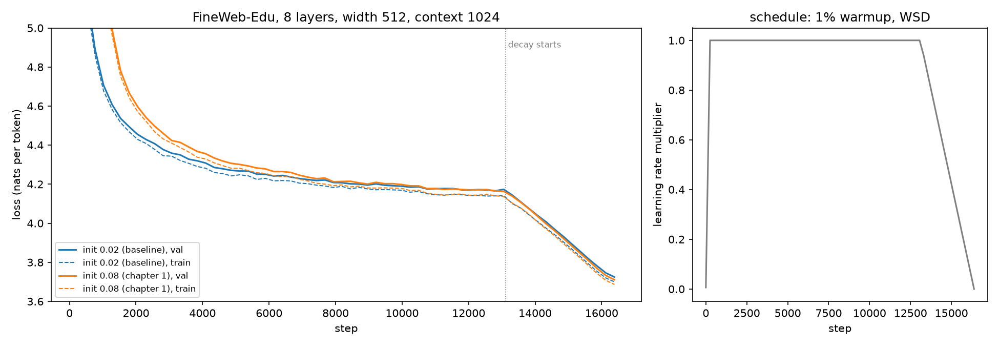
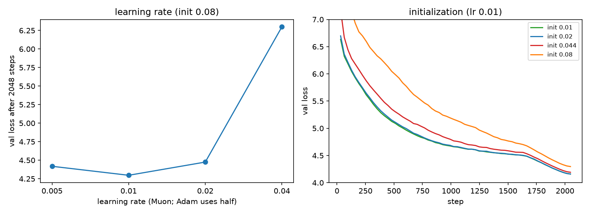

# 2.01 更大的模型，更多的数据

第二章要一项一项地看主流模型的架构改进。可是很多改进针对的问题，在第一章的设定里根本不会出现：

- 上下文只有 256，故事很短，位置编码和长上下文的差别看不出来；
- 内容单一，MoE 的专家分不开；
- 词表只有 1024，embedding 只占很少的参数，共不共享都无所谓。

所以这一节先把数据、上下文、模型都放大，模型结构完全不动，看两件事：**能训练到什么程度，第一章的训练配置还管不管用。** 这一节的结果就是第二章的基线。

## 放大了什么

| | 1.12 | 2.01 |
|---|---|---|
| 数据 | TinyStories（儿童故事） | **FineWeb-Edu**（教育类网页） |
| 分词器 | 自己训练的 bpe1024 | **GPT-2**，词表 50257 |
| 上下文 | 256 | **1024** |
| 层数 / 宽度 / 头数 | 6 / 256 / 4 | **8 / 512 / 8** |
| 参数量 | 531 万 | **7720 万**：Transformer 内部 2520 万，wte 和 lm_head 各 2580 万 |
| batch / 步数 | 64 × 256 / 65536 | **32 × 1024 / 16384** |
| 看过的 token | 10.7 亿 | **5.4 亿**，约为训练集的 0.72 遍，没有数据被看第二遍 |
| 初始化 | 0.08 | **0.02**，原因见下文 |
| 训练时间 | 13 分钟 | **54 分钟** |

模型结构、优化器（Muon 加 weight decay 0.1，配 Adam）、学习率调度（1% warmup，WSD）、bf16、编译，都和 1.12 一样。代码按第二章的新规范重写了：不变的部分（数据、评估、训练循环）放在 [../common.py](../common.py)，[train.py](train.py) 里只有模型。

### 数据

[FineWeb-Edu](https://huggingface.co/datasets/HuggingFaceFW/fineweb-edu) 是 HuggingFace 从网页里筛出来的教育类文本，比如百科、教程、科普文章。nanoGPT 一类的小模型实验常用它和它的母集 FineWeb。我们只用了它 100 亿 token 样本里的第一个分片：

- 前 1 万篇文档做验证集，共 1031 万个 token，评估时用开头的 512 个窗口，约 52 万个 token；
- 其余 71.6 万篇做训练集，共 7.42 亿个 token。

分词器用 GPT-2 的。词表补到 50304，矩阵乘法更快（1.09）。平均每个 token 是 4.61 个字节。编码见 [prepare.py](prepare.py)，32 个进程约 3 分钟。

### 指标从 bpb 换成 loss

从这一节开始，报告的是验证集上**每个 token 的平均 loss**，单位是 nats，也就是训练时 cross entropy 的那个值，不再换算成 bits per byte（bpb）。

1.05 换过分词器，不同分词器的 token 长短不一样，只有按字节算才能放在一起比。第二章的分词器固定是 GPT-2，就没有这个需要了。每个 token 的 loss 也是最常见的报告方式，nanoGPT 和 scaling law 的论文都用它。

### 模型多大

预算是正式训练 1 小时左右。[speed.py](speed.py) 测了几个尺寸的速度（batch 32 × 1024）：

| 层数 / 宽度 | 参数量（Transformer 内部） | 每步 | 每秒 token | 1 小时能训练 |
|---|---|---|---|---|
| 6 / 384 | 5000 万（1060 万） | 137 ms | 23.9 万 | 8.6 亿 |
| **8 / 512** | **7700 万（2520 万）** | **189 ms** | **17.3 万** | **6.3 亿** |
| 12 / 512 | 9000 万（3770 万） | 231 ms | 14.2 万 | 5.1 亿 |
| 12 / 768 | 1.63 亿（8490 万） | 390 ms | 8.4 万 | 3.0 亿 |

选了 8 层、宽 512。

- 训练 5.4 亿个 token，Transformer 内部每个参数大约分到 21 个 token。这接近 Chinchilla 的比例：DeepMind 的 Chinchilla 论文发现，给定计算量时，每个参数配 20 个左右的 token 最划算。
- 再大的话，一小时内看的数据太少；再小的话，又和 TinyStories 时期差不多。

还有一点值得注意：在这几个尺寸上，词表带来的参数和计算都不小。一个 5 万词的输出层，每个 token 要做 2580 万次乘法，和 8 层 Transformer 加起来差不多；峰值显存的大头也是它的 logits。

## 结果

左图：验证集（实线）和训练集固定窗口（虚线）的 loss，蓝色是基线（初始化 0.02），橙色是第一章的初始化 0.08。右图：学习率倍数。

| 步数 | 学习率倍数 | val loss |
|---|---|---|
| 0 | warmup | 11.02 |
| 1024 | 1 | 4.707 |
| 4096 | 1 | 4.308 |
| 8192 | 1 | 4.207 |
| 13056（衰减前最后一次评估） | 1 | 4.174 |
| 16384 | 0 | **3.725** |

训练用时 3262 秒，峰值显存 26.2 GB。

- **最终 val loss 3.725。** 作为大致的参照，GPT-2 124M 在 FineWeb 上训练 100 亿个 token，能到 3.28 左右。我们 Transformer 内部的参数只有它的 30%，数据只有 5%。两者的验证集也不同，FineWeb-Edu 更规整，所以只能粗略对照。
- **和第一章的数不能直接比。** 1.12 最终是 0.589 bpb，但那是简单得多的儿童故事，而且单位也不同。
- **衰减段又一次贡献了一大截**：从 4.174 降到 3.725，降了 0.45，和 1.12 一样是"恒定段积累，衰减段兑现"。恒定段的后半段几乎是平的，从第 8192 步到第 13056 步只降了 0.03。
- **训练集和验证集只差 0.025。** 数据只看了不到一遍，没有过拟合。

## 第一章的配置，还管不管用

### 学习率：不用改

每个学习率训练 2048 步，其余和正式训练相同（这时初始化还是 0.08）：

| lr | 0.005 | 0.01 | 0.02 | 0.04 |
|---|---|---|---|---|
| val loss | 4.418 | **4.297** | 4.475 | 6.299 |

最优还是 0.01，和 1.12 一样。Muon 的更新经过正交化，大小基本不随矩阵的尺寸变化，所以宽度从 256 加到 512，学习率也不用改。

### 初始化：0.08 一开始太大，但最后追平了

左图：扫学习率。右图：不同初始化在前 2048 步的 val loss（学习率都是 0.01）。

第一次正式训练用的是第一章的初始化 0.08，开头的 val loss 高达 113。对 5 万个 token 均匀地瞎猜，loss 也只有 ln 50257 ≈ 10.8。

原因是**输出层前面没有 norm**，这个结构是从 microgpt 一路沿用下来的。初始化 0.08 时，每一层往残差里加的东西都很大，残差的大小（均方根）从 1.0 一路涨到第 8 层的 14.8，logit 的标准差到了 26.8，模型一开始就极其自信地猜错。换成 0.02，残差只涨到 1.31，logit 的标准差是 0.59，开头的 loss 是 11.0，基本就是均匀瞎猜。

1.10 选 0.08 时，模型只有 1 层、宽 48，残差还来不及长大。

扫一下初始化（各 2048 步）：

| 初始化 | 开头 | 第 224 步 | 第 992 步 | 第 2048 步 |
|---|---|---|---|---|
| 0.01 | 10.86 | 5.726 | 4.676 | 4.160 |
| 0.02 | 11.02 | 5.745 | 4.687 | **4.159** |
| 0.044（≈ 1/√512） | 20.16 | 5.974 | 4.799 | 4.191 |
| 0.08 | 113.3 | 6.697 | 5.192 | 4.297 |

只看 2048 步，0.02 比 0.08 好了 0.14，于是换成 0.02 重跑了正式训练。**可是跑满以后，两者几乎一样**（见上面的曲线图）：

| 步数 | 1024 | 2048 | 4096 | 8192 | 11264 | 16384 |
|---|---|---|---|---|---|---|
| 初始化 0.08 | 5.245 | 4.597 | 4.356 | 4.214 | 4.173 | 3.711 |
| 初始化 0.02 | 4.707 | 4.455 | 4.308 | 4.207 | 4.178 | 3.725 |

- 0.08 前期吃亏，到第 1.1 万步左右追平，最后还略低 0.014。
- 我的猜测是：Muon 的更新量和参数本身的大小无关，weight decay 又每一步把参数往回拉，训练久了，初始化定下的尺度就被"忘掉"了。这个没有验证过。
- **基线还是用 0.02**，因为它和 GPT-2、nanoGPT 等主流做法一致，而且起点正常。

这也提醒我们：**短实验的结论不一定能代表完整训练。** 1.12 里加不加 weight decay，也是前期领先的那个最后输了。

## 生成的文本

开头给一句提示，温度 0.8：

> **In 1492,** the city of Montrose, which was home to Saint Cecilia (1492) and Thetshool-tiedmont, was the capital of the USA. From the 1492 it was also the eighth of the whole city of Pune. It was a city crowded into the middle, one of the largest cities and was climbing to the banks of the River Dialects in the 15th century BC.

> **Photosynthesis is** the process of decomposition through the fermentation of carbon dioxide (CO2) as much as possible. The carbon dioxide is the final product of the burning of the carbon dioxide used to generate electricity ...

语法通顺，用词也像教育类文章（"process"、"carbon dioxide"、"15th century"），能围着题目写下去。但事实全是错的，前后也接不上，比如"1492 年的美国首都"。这是几千万参数的模型该有的水平。

## 小结

- **基线**：8 层、宽 512、上下文 1024，7720 万参数，在 FineWeb-Edu 上训练 5.4 亿个 token，用时 54 分钟，val loss **3.725**。第二章后面各节都和它比。
- **第一章的训练配置基本能用。** Muon 加 weight decay、WSD 都照常工作，最优学习率也没变。
- **初始化 0.08 放大以后一开始太大**，问题出在输出层前面没有 norm。不过训练久了能追平，基线改用主流的 0.02。
- **输出层前面没有 norm，正是 2.03（归一化）要看的东西之一。**
