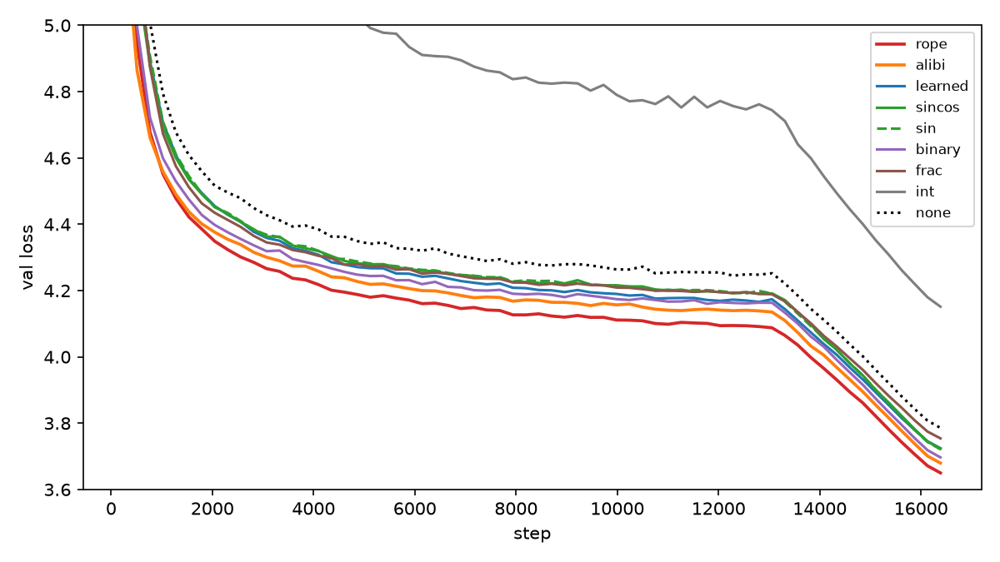
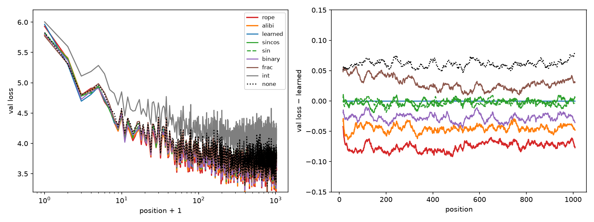
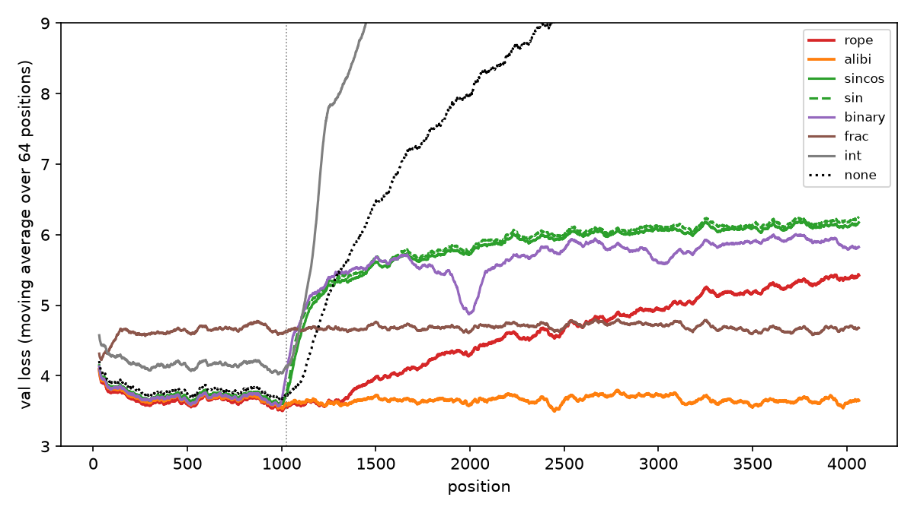

# 2.02 位置编码

## 问题

attention 本身不知道 token 的先后顺序。每个 query 对所有 key 打分、加权求和，把前面的 token 打乱，结果完全一样。可是 "dog bites man" 和 "man bites dog" 的意思不同，所以必须用某种办法把"第几个位置"告诉模型。

到 2.01 为止，我们一直用 GPT-2 的做法：每个位置一个可学的向量（wpe），加到 token embedding 上。这一节把主流的做法都试一遍，看三件事：

- 在训练的长度（1024）以内，哪种效果好；
- 每个位置上的差别是什么样子；
- 拿比训练时更长的序列去评估，谁还能用（外推）。

## 是什么

分三组，一共 9 种。设定全部和 2.01 相同：8 层、宽 512、上下文 1024、训练 16384 步，各跑一次。代码见 [train.py](train.py)，用 `pos=...` 选择。

### 第一组：把位置加到 embedding 上

这一组每一步都在修上一步的毛病，最后到达原版 Transformer 的做法：

| 名字 | 第 t 个位置加什么 | 修掉了什么，又留下什么 |
|---|---|---|
| int（整数） | 每一维都加 t | 最直接；但数值没有上限，到第 1000 个位置时，位置远远大于 token 本身 |
| frac（[0, 1]） | 每一维都加 t / (T − 1)，T 是这条序列的长度 | 有界了；但同样是第 100 个位置，序列长度不同，取值就不同 |
| binary（二进制） | t 的二进制，第 i 维放第 i 位 | 有界，也和序列长度无关；但取值是跳跃的，相邻位置之间的距离也不均匀 |
| sin | 第 i 维是 sin(t · ω_i)，ω_i = 1 / 10000^(i/d) | 连续、有界，从快到慢各种频率都有；但从位置 t 到 t+k 没有一个固定的变换 |
| sincos（原版 Transformer） | 每两维共用一个频率，一维 sin、一维 cos | 位置 t+k 的那一对 (sin, cos)，正好是位置 t 旋转 k·ω 的角度，旋转角只和距离 k 有关 |
| learned（GPT-2，2.01） | 每个位置一个可学的向量 | 不用人设计；但只有 1024 个，更长的序列没法用 |

**sin 和 sincos 要先缩小。** 我们在 embedding 相加之后紧接着做一次 RMSNorm。sin 的每一维约 0.7，而 token embedding 初始化时只有 0.02，直接相加的话，归一化以后几乎只剩下位置。原版 Transformer 的办法是把 token embedding 乘以 √d。由于后面紧跟着 RMSNorm，这和把位置表除以 √d（≈ 22.6）完全等价，我们用的是后一种写法。int、frac、binary 不缩放，照原样加，让它们的毛病露出来。

### 第二组：不加到 embedding 上，直接改注意力

- **RoPE**（旋转位置编码，Llama、Qwen、DeepSeek 等几乎所有现在的模型都用它）：把 sincos 的"旋转"直接作用在 q 和 k 上。每个头的 64 维分成 32 对，第 j 对按位置 t 旋转 t·θ_j 的角度，θ_j = 1 / 10000^(2j/64)。query 在位置 t、key 在位置 s 时，两次旋转在点积里抵消成 (t − s)·θ_j，所以注意力分数只和相对距离有关，和绝对位置无关。
- **ALiBi**（Attention with Linear Biases，BLOOM、MPT 用过）：q、k 都不动，只在注意力分数上减去 斜率 × 距离，越远减得越多。8 个头的斜率分别是 1/2、1/4、……、1/256：斜率大的头只看身边几个 token，斜率小的头能看到几百个 token 以外。

### 第三组：NoPE（不加位置编码）

什么都不加。模型仍然可以间接知道位置：因为有因果掩码，第 t 个位置能看到 t + 1 个 token。比如对前面的 token 求平均，看到的 token 越多，平均值的波动越小，这个"波动大小"就带着位置的信息（Haviv 等人，2022）。

## 怎么比

- **val loss**：和 2.01 一样，在 512 个固定的验证窗口上算。
- **每个位置的 loss**：同样这 512 个窗口，在每个位置上对所有窗口求平均（[eval.py](eval.py)）。
- **外推**：用更长的窗口（2048、4096）评估。每种长度都用约 52 万个验证 token。learned 只有 1024 个位置向量，跑不了。
- **外推时注意力落在哪**：取 4 个 4096 长的窗口，看最后 1024 个 query 分给"距离 ≥ 1024 的 key"的注意力占多少（[attention.py](attention.py)）。训练时的距离最多只有 1023。

所有的数都由 [plot.py](plot.py) 打印。

## 结果

### 1024 以内：RoPE 最好，ALiBi 其次

| 位置编码 | 第 1024 步 | 第 4096 步 | 衰减前（第 13056 步） | 最终 val loss |
|---|---|---|---|---|
| RoPE | 4.552 | 4.218 | 4.088 | **3.650** |
| ALiBi | 4.559 | 4.258 | 4.135 | 3.680 |
| binary | 4.599 | 4.277 | 4.163 | 3.697 |
| sin | 4.709 | 4.320 | 4.191 | 3.721 |
| sincos | 4.693 | 4.319 | 4.192 | 3.723 |
| learned（2.01） | 4.707 | 4.308 | 4.174 | 3.725 |
| frac | 4.673 | 4.305 | 4.189 | 3.754 |
| NoPE | 4.794 | 4.385 | 4.252 | 3.786 |
| int | 6.023 | 5.103 | 4.744 | 4.151 |

- **改注意力的两种最好。** RoPE 比 learned 低 0.075，而且从第 1000 步左右起就一直领先。整个训练过程中，各条曲线的先后顺序基本不变。
- **sin、sincos、learned 几乎一样。** 在 1024 以内，人设计的固定表和让模型自己学，效果没有差别。sin 和 sincos 的区别（能不能用"旋转"表示距离）在这里也看不出来。
- **binary 意外地比 learned 还好一点。** 原因我没有弄清楚。
- **frac 只比 learned 差一点。** 训练时每条序列都是 1024 长，t / (T − 1) 只是把整数缩小了 1023 倍，"不同长度取值不同"的毛病还没机会出现。
- **NoPE 确实学到了位置**，只比 learned 差 0.06。
- **int 差得最多**，高了 0.43。它的 token embedding 比 learned 的大了将近一倍（均方根 0.89 对 0.47），可和动辄几百的位置值比起来还是太小了。模型最后是怎么把 token 的信息读出来的，我没有去查。

训练时间：多数在 3300 秒左右。RoPE 3612 秒、ALiBi 3661 秒，多出的是在注意力里额外做的计算。sincos 是 5264 秒，NoPE 是 3882 秒，但它们每步的计算量和 sin、learned 差不多，应该是那段时间服务器上有别的负载。

### 每个位置：差别在哪儿都一样

左图：每个位置的 val loss，横轴取对数。所有方法的形状都一样：第 0 个位置 loss 接近 6，因为什么上文都没有；到一两百个位置以后基本变平。右图：减去 learned 之后的差，做了 32 个位置的滑动平均。所有模型用的是同一批窗口，左图的起伏来自文本本身，减掉以后才看得清差别。int 高了约 0.4，在右图外面。

| 位置 | 16–127 | 128–511 | 512–1023 |
|---|---|---|---|
| RoPE | 3.828 | 3.620 | 3.605 |
| ALiBi | 3.857 | 3.655 | 3.632 |
| learned | 3.904 | 3.701 | 3.676 |
| NoPE | 3.964 | 3.761 | 3.738 |

各方法的差别**在整个 1024 长度上基本是平移**：RoPE 在靠前、居中、靠后的位置都比 learned 低 0.07 到 0.08，NoPE 都高 0.06。并不是"某种编码只在远处好"。

### 外推：只有 ALiBi 撑住了

窗口拉到 4096，每个位置的 loss（64 个位置的滑动平均）。虚线是训练长度 1024。

| 位置编码 | 1024 窗口 | 2048 窗口，超过 1024 的部分 | 4096 窗口，超过 1024 的部分 |
|---|---|---|---|
| ALiBi | 3.680 | **3.629** | **3.657** |
| RoPE | **3.650** | 3.945 | 4.638 |
| frac | 3.754 | 3.921 | 4.690 |
| binary | 3.697 | 5.344 | 5.654 |
| sincos | 3.723 | 5.394 | 5.830 |
| sin | 3.721 | 5.466 | 5.886 |
| NoPE | 3.786 | 6.311 | 8.634 |
| int | 4.151 | 9.536 | 12.204 |
| learned | 3.725 | 跑不了 | 跑不了 |

- **ALiBi 是一条平线。**
- **RoPE 过了 1024 以后慢慢往上爬**，到 4096 时比训练长度以内高了约 1。
- **sin、sincos、binary 一过 1024 就跳到 5 以上。** 这些编码在任何位置都算得出来，可模型从来没见过那些位置的值。
- **NoPE 外推得很差**，越往后越高。它是靠"能看到多少个 token"间接知道位置的，看到的 token 一多，这个信号就超出了训练时的范围。
- **frac 的毛病在这里暴露了**：窗口一变长，所有位置的取值都变了，连前 1024 个位置也一起变差（1024 窗口时 3.754，4096 窗口时 4.615），整条线被抬高。其他方法在前 1024 个位置上基本不受窗口长度影响，因为它们是因果的，第 t 个位置的结果只取决于前 t 个 token。
- binary 在 2000 附近有一个下凹，我没有解释。

## ALiBi 为什么能外推

**因为它从来不往远处看，所以远处变长了也不影响它。**

ALiBi 的偏置是 −斜率 × 距离，是一个固定的公式，不用学，对任何距离都算得出来。更关键的是，它在距离稍远时就已经非常负了：

- 斜率最小的那个头（1/256），距离 1024 时偏置是 −4，相当于注意力权重乘以 e⁻⁴ ≈ 0.018；
- 其余的头衰减得更快，斜率 1/2 的头在距离 10 时偏置就是 −5。

所以训练时，每个头都只看一个有限的范围。外推时，超过 1024 的那些 key 偏置更负，几乎分不到注意力。每个 query 实际看到的，和训练时一样，是身边那一段。量一下就很清楚（4096 窗口，最后 1024 个 query）：

| | 分给距离 ≥ 1024 的 key 的注意力 |
|---|---|
| 均匀分配时（对照） | 0.712 |
| ALiBi，所有层、所有头平均 | **0.003**（最多的一个头 0.033） |
| RoPE，所有层、所有头平均 | **0.677**（最少的一个头 0.205，最多的 0.943） |

ALiBi 几乎完全不看 1024 以外的 token。RoPE 正好相反：它分给远处的注意力已经接近均匀分配，而这些距离是它训练时从没见过的。

**RoPE 为什么不行。** RoPE 的 32 对维度旋转得有快有慢。最慢的那一对，每个位置转 1/10000^(62/64) ≈ 0.00013 弧度，训练的 1024 个位置里只转了 0.14 弧度。周期超过 1024 的有 14 对，第 18 对到第 31 对，在训练里一圈都没转完。超过 1024 以后，这些维度转到了从没见过的角度，q·k 就成了模型没见过的数，注意力被拉到远处，越往后越乱。

**代价是：ALiBi 的"外推"并没有用上更长的上下文。** 2048 窗口里，超过 1024 的部分 loss 是 3.629，和 1024 以内靠后位置的 3.632 一样。多看到的上文没有带来任何好处。它只是"不会变坏"，而不是"能用更长的上下文"。

## ALiBi 和 RoPE 的权衡

| | ALiBi | RoPE |
|---|---|---|
| 训练长度以内 | 3.680 | **3.650** |
| 直接拉长 | **不变坏**，但也用不上多出来的上文 | 变坏，需要额外处理 |
| 对远处的看法 | 写死的：越远越不看，每个头有固定的视野 | 学出来的：模型可以根据内容决定看多远 |
| 实现 | 要往注意力分数里加偏置。我们把偏置矩阵整个算出来传进去，用不上最快的注意力实现（FlashAttention-2 后来原生支持了 ALiBi） | 只改 q、k，和任何注意力实现都兼容 |

ALiBi 的偏置是写死的，这既是它外推稳定的原因，也是它的限制：模型没法根据内容决定"这一段很重要，即使很远也要看"。RoPE 把决定权留给了模型，所以在训练长度以内更好，代价是超出训练长度就会出问题。

后来的模型几乎都选了 RoPE。现在的做法是：用较短的上下文训练大部分步数，最后用更长的上下文再训练一小段。配合调整 RoPE 的频率（比如把 base 从 10000 调大，Llama 3 用的是 50 万；或者用 YaRN 这类方法把位置"压缩"回训练过的范围），只需少量训练就能把上下文拉长。反正要专门训练长上下文，"不训练就能外推"这个优点就不那么重要了；而 RoPE 在训练长度以内更好，又和高效的注意力实现兼容。

## 小结

- **训练长度以内**：RoPE 3.650 最好，ALiBi 3.680 其次。sin、sincos、learned 几乎一样，都在 3.72 左右。NoPE 也能学到位置，只差 0.06。int 最差。
- **差别在每个位置上都一样**，是整体的平移。
- **外推**：只有 ALiBi 不变坏，原因是它几乎不往 1024 以外看，所以也用不上更长的上下文。RoPE 超出训练长度后，注意力被拉到没见过的距离上，loss 逐渐上升。
- **之后的各节用 RoPE。**

## 和大模型的关系

- Llama、Qwen、DeepSeek、Kimi 等主流模型都用 RoPE，只是 base 更大（Llama 3 是 50 万），以适应更长的上下文。
- 长上下文靠专门的训练阶段加 RoPE 的频率调整（位置插值、NTK、YaRN）。我们这里看到的"超出 1024 就变坏"，正是这些方法要解决的问题。
- BLOOM（2022）和 MPT（2023）用过 ALiBi，之后的主流模型基本没有再用。
